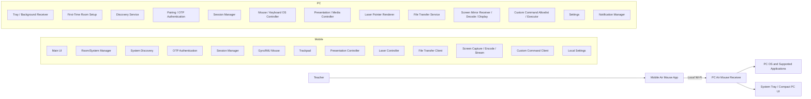
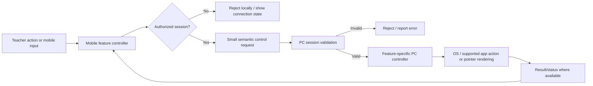
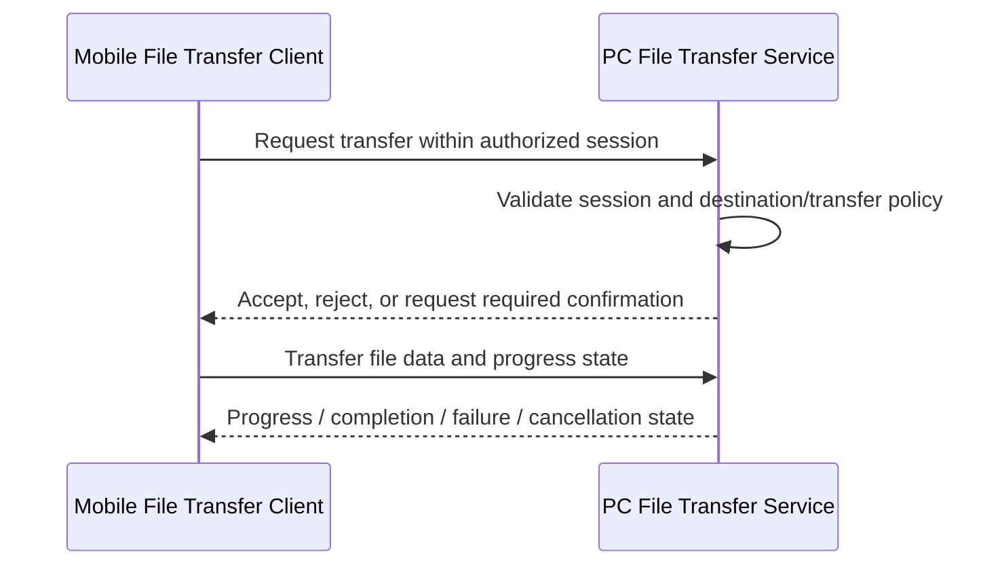
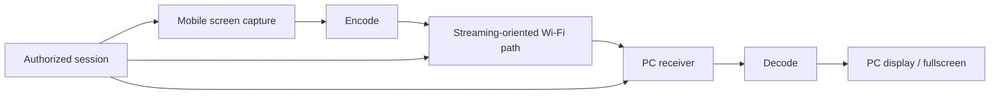
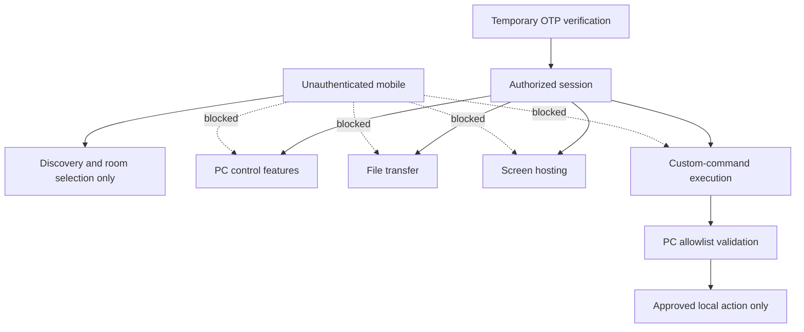

# Air Mouse for College Teaching — Architecture

## 1. Scope and Principles

Air Mouse is a local, teacher-focused control system:

```text
Mobile Phone → Local Wi-Fi → PC Receiver → Classroom PC / OS
```

The mobile phone is the teacher’s controller. The classroom PC runs the Air Mouse receiver mainly in the background/system tray. The system supports multiple classroom PCs and prioritizes simple setup, low-latency controls, reliability, and safe authorization.

Confirmed constraints:

- Phone communicates directly with the PC over local Wi-Fi.
- No ESP32, Arduino, Bluetooth controller, or other intermediary hardware.
- Room number is the teacher-facing PC identity.
- QR contains only room number and is used for room registration, not authentication.
- Selecting a reachable saved room causes the PC to show a temporary OTP; entering it establishes an authorized session.
- Internal device identity, if needed, remains separate from room number.
- No unnecessary cloud, microservice, or deployment infrastructure.

Programming languages, frameworks, protocols, ports, libraries, databases, exact security primitives, codecs, and deployment technology are **TBD**. Choices must be driven by local-network operation, low latency, platform capability, security, maintainability, and suitability for a college-project prototype.

## 2. Overall Architecture



The diagram identifies logical responsibilities, not separate deployable services. The prototype should keep these responsibilities within the mobile app and PC receiver rather than creating unnecessary networked components.

## 3. Mobile Architecture

| Component | Responsibility |
|---|---|
| Main UI | Teaching-focused controls, connected room/status, mode selection, presentation actions, file sharing, screen hosting, custom commands, and access to advanced settings. |
| Room/System Manager | Stores and displays saved room numbers; supports registration, selection, removal, and availability state. |
| System Discovery | Locates reachable Air Mouse PCs on current local Wi-Fi and associates discovered systems with saved rooms. Mechanism is **TBD**. |
| OTP Authentication | Presents selected-room OTP entry and submits authentication request; QR is never used as authentication. |
| Session Manager | Tracks disconnected, discovering, authentication, connected, reconnecting, and terminated states; gates feature use on authorization. |
| Gyro/IMU Mouse Controller | Samples/processes authorized gyro input and produces cursor deltas. Details in `IMU.md`. |
| Trackpad Controller | Converts touch gestures into relative cursor, click, drag, and scroll actions. Details in `MOUSE.md`. |
| Presentation Controller | Sends semantic presentation/media commands, such as `NEXT_SLIDE`, rather than arbitrary OS commands. |
| Laser Pointer Controller | Controls laser feature state and real-time pointer input; rendering is PC-side. |
| File-Transfer Client | Selects/sends/receives files, shows progress, and handles cancellation/error in authenticated sessions. |
| Screen Capture/Encoding/Streaming Client | Captures full mobile screen, encodes it, and sends a real-time stream to PC. Exact implementation is **TBD**. |
| Custom-Command Client | Requests approved semantic command IDs; never exposes arbitrary shell command execution. |
| Local Settings/Configuration | Stores user preferences, saved rooms, mouse settings, calibration data, and permitted local UI configuration. |

## 4. PC Architecture

| Component | Responsibility |
|---|---|
| System-Tray/Background Receiver | Primary PC runtime; receives authorized communication while staying unobtrusive during teaching. |
| First-Time Room Setup | Collects room number, generates/displays QR containing only room number, then enters waiting state. |
| Discovery Service | Makes an available PC discoverable on local Wi-Fi. Exact mechanism is **TBD**. |
| Pairing/OTP Authentication | Generates temporary OTP for selected room, validates submitted OTP, rejects failures, and starts authorized session on success. |
| Session Manager | Maintains authorized-session state, expiration/disconnection behavior, and request authorization checks. |
| Mouse/Keyboard OS Controller | Converts authorized cursor/click/scroll and presentation-compatible input into normal local OS behavior. Exact integration is **TBD**. |
| Presentation/Media Controller | Translates semantic presentation/media intent into supported local action without requiring the phone to know the application. |
| Laser-Pointer Renderer | Displays classroom-visible pointer overlay/rendering. Exact rendering approach is **TBD**. |
| File-Transfer Service | Receives/sends files in authorized sessions; handles destination configuration, progress, cancellation, and failure. |
| Screen-Mirroring Receiver/Decoder | Receives, decodes, and displays full mobile screen stream, including fullscreen behavior. |
| Custom-Command Allowlist/Executor | Validates requested command against approved local actions and executes only allowed actions. |
| Settings/Configuration | Stores room configuration, approved commands, transfer destination/configuration, and local receiver settings. |
| Notification Manager | Provides compact tray-level notifications for meaningful teaching-time events. |

## 5. Communication Planes

Communication is logically separated by workload and security need. Exact channels, protocols, and message formats are **TBD**.

| Plane | Purpose | Requirements |
|---|---|---|
| Discovery | Locate reachable Air Mouse PCs on current local Wi-Fi. | Local-network focused; room-number-oriented UI; no teacher-facing technical metadata. |
| Authentication/session establishment | OTP exchange/verification and authorized-session setup. | Explicit temporary OTP; authorization before control; failure/expiry handling. |
| Low-latency control | Cursor deltas, clicks, trackpad gestures, laser updates, and semantic presentation/media commands. | Small messages, minimal delay, no unnecessary buffering, stale-command protection. |
| File transfer | Phone↔PC file delivery. | Authenticated session, progress, cancellation, safe destination handling, interruption handling. |
| Real-time screen streaming | Mobile full-screen capture/encode/transmit and PC decode/display. | Streaming-oriented path, low latency, quality/FPS adaptation, rotation/recovery behavior. |

Screen mirroring and large file transfer must not be treated as ordinary control messages. They have substantially different payload size, timing, flow-control, recovery, and quality requirements. Control input should remain responsive even while a file transfer or screen stream is active, subject to actual network capacity.

## 6. Pairing and Session Flow

Discovery and authentication are separate:

- Discovery identifies reachable systems and presents room numbers.
- QR registers a room number on mobile; it is not an access credential.
- OTP verifies an intended connection to a selected reachable PC.
- Successful OTP creates an authorized session; session authorization gates all control and transfer/stream features.

```mermaid
sequenceDiagram
    participant PC as PC Receiver
    participant M as Mobile App
    PC->>PC: First setup: configure room number
    PC->>PC: Generate QR containing room number only
    PC-->>M: Display QR for registration
    M->>M: Scan QR; save room number
    M->>M: Discover reachable local PCs
    M->>PC: Select saved reachable room
    PC->>PC: Generate temporary OTP
    PC-->>M: OTP shown to teacher for manual entry
    M->>PC: Submit OTP authentication request
    PC->>PC: Validate OTP and session eligibility
    PC-->>M: Authorized session established or rejected
```

OTP length, generation, expiry duration, retry/rate-limit policy, replay protection, transport protection, session token design, and session-expiration mechanism are **TBD**. QR must never contain passwords, OTPs, network credentials, private keys, or other secrets.

## 7. Control Command Flow

The mobile sends semantic command IDs, never arbitrary OS/shell commands. Examples include `NEXT_SLIDE`, `PREVIOUS_SLIDE`, `VOLUME_UP`, `MUTE`, `PLAY_PAUSE`, and `START_PRESENTATION`.



For pointer control, semantic input may be relative cursor/gesture intent rather than a named presentation command; PC still validates session and permitted feature before acting. Protocol-level identifiers, timestamps, acknowledgements, and duplicate handling are defined in `API_PROTOCOL.md` when available.

## 8. File Transfer Flow



The same authorized-session requirement applies to PC→phone transfer. PC handles configured download location and safe path handling. Transfer history is intentionally out of scope. Interrupted transfers must fail clearly and must not be presented as completed. Transfer transport, resume behavior, checksum/integrity mechanism, and exact transfer protocol are **TBD**.

## 9. Screen Mirroring Flow



Screen hosting is full real-time mobile screen mirroring. The PC receiver validates authorization before accepting stream start/data. The mobile supports start/stop while the teacher continues to use the phone. Portrait, landscape, rotation, quality/FPS settings, hardware acceleration where available, failure, and recovery requirements follow `FEATURES.md` and `UI_UX.md`.

Codec, streaming mechanism, congestion/quality adaptation, hardware acceleration details, and reconnection policy are **TBD**. A stream must use a streaming-oriented path rather than ordinary control messages.

## 10. Security Boundaries



Security requirements:

- Room number is identity/selection, not authorization.
- QR is registration only, not authentication.
- Temporary OTP is required before authorized session creation.
- PC validates session authorization for all control, transfer, stream, and custom-command requests.
- Session expiration/disconnect invalidates authorization appropriately.
- Custom commands require PC allowlist validation; unrestricted remote shell execution is not allowed by default.
- File transfer and screen streaming require authorized session by default.
- Unknown, invalid, stale, or unauthorized requests are rejected.

Specific cryptographic algorithms and transport protections are **TBD**. They must be selected to protect local-network communication without adding unjustified complexity.

## 11. Reliability and Recovery

| Situation | Required high-level behavior |
|---|---|
| PC unavailable / room not discovered | Mobile shows unavailable, retains saved room, and allows discovery/retry. |
| Wrong or expired OTP | PC rejects authentication; mobile requests retry/current OTP. |
| Wi-Fi or network change | Treat existing reachability/session as invalid until rediscovery/recovery succeeds. |
| Temporary disconnection | Stop active control safely; show reconnecting; do not continue stale input. |
| Reconnection | Resume only under valid session policy; re-authentication behavior is **TBD**. |
| PC receiver restart | End previous session safely; PC returns to discoverable/waiting state; mobile rediscovers/re-authenticates as required. |
| Mobile app restart | Restore local settings/saved rooms, but do not assume old authorization remains valid. |
| Duplicate/stale control command | Avoid duplicate local action where practical; do not replay stale actions after reconnect. Mechanism is **TBD**. |
| File-transfer interruption | Mark transfer interrupted/failed; do not report completed; resume policy is **TBD**. |
| Screen-stream interruption | Pause/end stream safely, report state, attempt recovery only according to final policy. |

A connection loss must not produce stale cursor deltas, delayed presentation actions, accidental drag continuation, or unexpected stream/file completion claims.

## 12. Data and Storage Boundaries

All listed information is local unless future requirements explicitly justify otherwise. Cloud storage is not required.

| Side | Local information |
|---|---|
| Mobile | Saved room numbers; local connection preferences; local UI/settings; mouse/trackpad settings; IMU calibration data; transfer preferences; temporary session information as needed. |
| PC | Configured room number; internal system identity if required; PC receiver settings; authorized-session state as needed; file-transfer configuration/destination; custom-command allowlist/configuration; display/hosting settings; notification preferences. |

OTP is never a permanent credential. Exact storage formats, encryption-at-rest policy, retention, and clearing behavior are **TBD**. File-sharing history is intentionally not required.

## 13. UI Architecture

The mobile main screen keeps frequent teaching controls—connected room/status, Gyro Mouse, Trackpad, Laser Pointer, Calibrate, Presentation Controls, Share File, Screen Hosting, and Custom Commands—directly available. Advanced configuration is grouped in a three-dot menu.

The PC runs primarily from the system tray/background. Its compact panel exposes room number, system/connection/device status, feature statuses, disconnect action, and settings without requiring a large window during teaching. OTP and first-time room QR setup use focused PC views.

Both interfaces follow the same glassmorphism visual language, light/dark theme philosophy, names, icon concepts, and status meanings. Full UI requirements are in `UI_UX.md`.

## 14. Confirmed vs. TBD Decisions

| Area | Confirmed requirement | TBD decision criteria |
|---|---|---|
| Connectivity | Direct local Wi-Fi phone-to-PC communication | Discovery and transport mechanisms: local reachability, security, simplicity, platform support. |
| Identity | Room number is teacher-facing; internal ID may exist | Internal-ID design and duplicate-room disambiguation. |
| Registration | QR contains only room number | QR format/validation details. |
| Authentication | Temporary PC-displayed OTP establishes authorized session | OTP generation, expiry, retry/reuse protection, session token/mechanism. |
| Controls | Semantic commands; no arbitrary shell control | Message format, acknowledgement, duplicate protection. |
| Screen hosting | Full real-time mobile mirroring | Codec, stream transport, adaptation, hardware acceleration. |
| File sharing | Both directions, authenticated by default, no history | Transfer transport, integrity/resume behavior. |
| PC integration | PC translates feature intent to local behavior | OS/application integration and presentation target strategy. |
| Security | Authorization gates privileged actions; allowlisted custom commands | Cryptographic and transport details. |

## 15. Documentation Boundaries

This architecture aligns with and delegates detailed behavior to:

- `PRD.md`: product requirements, if present.
- `FEATURES.md`: complete feature behavior/dependencies.
- `UI_UX.md`: detailed mobile and PC UI/UX requirements.
- `PAIRING.md`: discovery, OTP, authorization, and connection lifecycle.
- `MOUSE.md`: user-facing Gyro/Trackpad behavior.
- `IMU.md`: sensor processing and calibration requirements.
- `PRESENTATION.md`: presentation/media command behavior.
- `NETWORK.md` and `API_PROTOCOL.md`: future detailed communication/protocol requirements, if created.

## 16. Architecture Acceptance Criteria

A developer or AI can use this document to determine:

- What runs on the phone and what runs on the PC.
- How phone and PC communicate directly over local Wi-Fi.
- How QR registration, room discovery, OTP authentication, and authorized sessions work.
- How mouse, presentation, laser, file transfer, Screen Hosting, and Custom Commands reach the PC.
- Which paths require low latency and why streaming/file data is separated from ordinary controls.
- Where authorization and allowlist security boundaries are enforced.
- How PC/mobile restart, disconnection, stale input, interruption, and reconnection are handled.
- Which technical mechanisms remain **TBD** and what criteria govern their selection.
