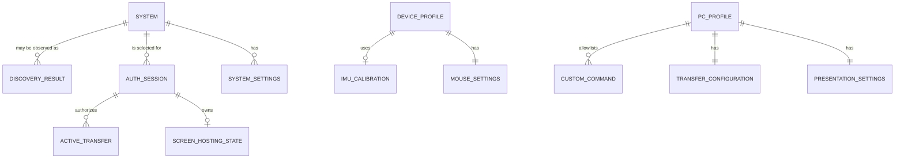

# Air Mouse for College Teaching — Logical Data Model

## 1. Purpose and Goals

This document defines the logical information model for the Air Mouse mobile application and PC receiver. It describes what information the system stores or keeps temporarily without choosing a database, serialization format, programming language, framework, or storage technology.

The model supports:

- Classroom/room identification.
- Saved PC systems.
- Pairing and session state.
- IMU calibration.
- Mouse settings.
- Presentation settings.
- Custom Commands.
- File-transfer configuration and active state.
- Screen-mirroring configuration and active state.
- General application preferences.

Persistent data must remain minimal. The project explicitly has **no persistent file-transfer history**.

## 2. Data Model Principles

- **Room number is user-facing identity.** It identifies a classroom PC to teachers.
- **Internal system identity is implementation-level.** It may distinguish systems but does not replace room number in normal UI.
- **QR contains only room number.** QR registration is not authentication data.
- **OTP and session data are temporary.** OTP is never a permanent credential.
- **Configuration is local unless future requirements explicitly state otherwise.** No cloud storage is required.
- **Raw sensor data is not persistently stored.** Store only calibration results/configuration needed for Gyro Mouse.
- **No recordings, stored screen frames, or file-transfer history.**
- **Exact field types, storage layout, encryption-at-rest, and persistence technology are TBD.**

## 3. Core Entities

| Entity | Purpose | Persistence |
|---|---|---|
| System/Room | Represents a classroom PC known to the mobile app or PC receiver. | Persistent where saved/configured; availability is temporary. |
| Discovery Result | Current reachable-system observation. | Temporary. |
| Pairing/Registration State | Room registration context, such as QR-derived room number. | Saved room registration may persist; active pairing is temporary. |
| OTP Authentication State | Current temporary OTP challenge/attempt state. | Temporary. |
| Authorized Session | Active authenticated mobile↔PC control context. | Temporary. |
| IMU Calibration Profile | Gyro bias/offset/reference data for profile/device context. | Persistent while valid. |
| Mouse Settings | Gyro and Trackpad preferences. | Persistent. |
| Presentation Settings | User/PC feature preferences for semantic presentation controls. | Persistent where needed. |
| Custom Command Definition | Teacher-visible command and approved PC-side action reference. | Persistent on authoritative PC configuration. |
| Active File Transfer | Current transfer metadata/status/progress. | Temporary. |
| File Transfer Configuration | PC destination and related transfer preferences. | Persistent. |
| Screen Hosting Configuration | Quality/FPS/orientation/display preferences. | Persistent. |
| Active Screen Hosting State | Current stream/hosting state. | Temporary. |
| Application Preferences | Theme, notifications, UI and non-sensitive preferences. | Persistent. |

## 4. Room/System Model

A System/Room model represents a classroom PC.

| Concept | Meaning | Persistence/visibility |
|---|---|---|
| Internal system/device identifier | Opaque implementation-level identity used to distinguish systems where necessary. | May persist; not normal teacher-facing UI. |
| Room number | Teacher-facing classroom identity, such as a room label/number. | Persistent in saved/configured systems; shown in UI. |
| Saved state | Indicates the room was registered/saved on mobile. | Persistent on mobile. |
| Reachability/availability | Current discovered network availability. | Temporary. |
| Connection state | Disconnected, discovering, selected, awaiting OTP, authenticating, connected, reconnecting, unavailable. | Temporary. |
| Last-known connection context | Minimal implementation context useful for re-discovery or display where appropriate. | Optional; exact data is **TBD**; not teacher-facing technical data. |

Room number is not an authorization credential. Internal identity and network address are separate concepts. Network addresses, hostnames, ports, and MAC addresses must not become normal teacher-facing saved-room data.

The QR code generated by PC first-time setup contains only room number. Scanning it creates/updates a saved room registration but does not create authorization.

## 5. Pairing and Session Model

### Persistent pairing/registration information

Persistent mobile registration may include saved room number, associated opaque internal identity where needed, local display/preference metadata, and registration/configuration version. It must not include permanent OTP or unselected security secrets.

### Temporary authentication/session information

| Concept | Purpose |
|---|---|
| Selected system context | Which reachable room/receiver is being authenticated. |
| OTP challenge state | Temporary PC-displayed OTP and expiry/attempt state as required by side. |
| Authentication attempt state | Waiting, submitting, accepted, rejected, expired, rate-limited, unavailable. |
| Session identity/context | Temporary authorized session identifier/context required for request validation. Exact form is **TBD**. |
| Session authorization state | Whether privileged controls/features are currently permitted. |
| Session lifetime/expiry | Temporary validity state/timing according to final policy. |
| Reconnection state | Temporary recovery/re-authentication context. |

OTP expires and must be deleted/invalidated after use, expiration, cancellation, or relevant PC/session restart. Active session information is invalidated on explicit disconnect, session expiry, PC restart, relevant mobile restart policy, or security/network lifecycle event. Detailed behavior follows `PAIRING.md` and `SECURITY.md`.

## 6. IMU Calibration Model

An IMU Calibration Profile contains only calibration information needed for Gyro Mouse behavior. It avoids persistent raw motion/sensor history.

| Concept | Purpose |
|---|---|
| Calibration status | Uncalibrated, calibrating, calibrated, invalid, reset, or error. |
| Sensor bias/offset values | Correct gyro/accelerometer signals where used. Exact values/form are **TBD**. |
| Reference orientation | Orientation/reference state if final IMU design requires it. |
| Calibration timestamp | Indicates when valid calibration was produced. |
| Calibration/version metadata | Supports validity/version compatibility across app updates. |
| Calibration validity | Indicates accepted, expired, invalidated, or reset state. |
| Associated device/profile | Associates calibration with appropriate phone/device or local profile context. Exact identity policy is **TBD**. |

Calibration persists across normal restarts while valid. Recalibration replaces prior data only after valid completion. Failed calibration should preserve prior valid data where practical. Reset calibration deletes/inactivates calibration data and returns Gyro operation to defined uncalibrated/default behavior.

## 7. Mouse Settings Model

### Gyro Mouse settings

| Setting | Purpose | Default |
|---|---|---|
| Axis mode | Select XY, XZ, or YZ axis pair. | TBD — determine through testing |
| X inversion | Invert X-axis direction. | TBD — determine through testing |
| Y inversion | Invert Y-axis direction. | TBD — determine through testing |
| Z inversion | Invert Z-axis direction. | TBD — determine through testing |
| X sensitivity | Per-axis response multiplier. | TBD — determine through testing |
| Y sensitivity | Per-axis response multiplier. | TBD — determine through testing |
| Z sensitivity | Per-axis response multiplier. | TBD — determine through testing |
| Overall sensitivity | Global cursor response multiplier. | TBD — determine through testing |
| Acceleration | Speed-dependent cursor response configuration. | TBD — determine through testing |
| Dead zone | Tiny-motion threshold configuration. | TBD — determine through testing |
| Noise filtering configuration | Exposed filtering strength/type where applicable. | TBD — determine through testing |
| Drift compensation configuration | User-exposed drift behavior where applicable. | TBD — determine through testing |
| Stationary detection | User-exposed stationary behavior where applicable. | TBD — determine through testing |
| Haptic feedback | Enables/disables relevant haptic feedback. | TBD — determine through testing |

### Trackpad settings

| Setting | Purpose | Default |
|---|---|---|
| Sensitivity | Relative cursor response to touch movement. | TBD — determine through testing |
| Acceleration | Speed-dependent Trackpad response. | TBD — determine through testing |
| Gesture configuration | Permitted/optional gesture behavior. | TBD — determine through testing |
| Scroll behavior | Vertical/horizontal scroll preferences/sensitivity where exposed. | TBD — determine through testing |

### Temporary mouse state

Mouse lock/pause, selected active mouse mode, active drag state, current touch sequence, and current sensor-tracking state are temporary session/runtime state. They must not produce stale cursor actions after disconnect or restart.

## 8. Presentation Settings Model

Presentation settings include only user preferences/feature configuration necessary for semantic presentation control. Do not model every OS/application-specific implementation detail.

Semantic command set:

- `NEXT_SLIDE`
- `PREVIOUS_SLIDE`
- `START_PRESENTATION`
- `END_PRESENTATION`
- `BLANK_SCREEN`
- `VOLUME_UP`
- `VOLUME_DOWN`
- `MUTE`
- `PLAY_PAUSE`

Logical settings may include presentation-control availability/preferences, confirmation preference for disruptive actions where applicable, and PC-side configured semantic capability/mapping metadata where needed. Exact application-specific mapping remains PC-side, is not mobile UI data by default, and is **TBD**.

Current presentation active/blank/mute/play state is temporary and must be distinguished from actual PC-provided state versus mobile-requested state.

## 9. Custom Command Model

A Custom Command Definition is a logical entity. Detailed persistence schema belongs in `DATA_MODEL.md` implementation design and must not model unrestricted shell commands.

| Concept | Purpose |
|---|---|
| Command ID | Stable unique semantic identifier used for mobile request and PC allowlist lookup. |
| Display name | Teacher-visible command title. |
| Description | Optional teacher-visible explanation. |
| Enabled/disabled | Controls availability for execution. |
| Approved action reference | Reference to PC-side approved local action/mapping, not arbitrary executable text. |
| Permitted optional parameters | Restricted validated parameters only where required. |
| Confirmation requirement | Whether execution needs user confirmation. |
| Creation/update metadata | Optional audit/configuration metadata where useful; exact retention is **TBD**. |
| Execution availability/status | Temporary/runtime indication of current target availability where known. |

User-facing command definition is distinct from PC-side approved execution mapping. PC is authoritative for allowlist and action mapping. Do not store unrestricted shell command text, terminal text, arbitrary executable paths, or unrestricted script definitions as normal Custom Command data.

## 10. File-Sharing Model

### Persistent transfer configuration

PC may persist configurable default receive/download directory and related safe transfer preferences. Exact configuration fields are **TBD**. Destination configuration must remain within allowed local PC boundaries.

### Temporary active transfer state

| Concept | Purpose |
|---|---|
| Transfer ID | Identifies current transfer lifecycle. |
| Direction | Phone → PC or PC → Phone. |
| Filename | User-visible selected file name after safe validation. |
| File size | Progress/capacity context where available. |
| Progress | Percentage or equivalent active progress. |
| Status | Selecting, preparing, transferring, completed, cancelled, failed, connection lost. |
| Source/destination context | Selected source and authorized destination context. |
| Error state | Safe failure category/recovery information. |
| Session association | Authorized session context governing transfer. |

**No persistent file-transfer history is stored.** Temporary transfer state is deleted/cleared after completion, cancellation, failure, or cleanup policy completion. Partial-file cleanup behavior is implementation-dependent and **TBD**, but partial files must not be represented as completed transfers.

## 11. Screen-Hosting Model

### Persistent Screen Hosting configuration

| Concept | Purpose |
|---|---|
| Quality preference | User-configurable quality level where practical. |
| FPS preference | Target frame-rate preference where practical. |
| Resolution/bitrate preference | Configuration where practical. |
| Orientation/display preference | Display/fullscreen/orientation behavior where exposed. |
| Hardware-acceleration preference/capability | Availability/preference state where useful; exact form is **TBD**. |

### Temporary active Screen Hosting state

| Concept | Purpose |
|---|---|
| Hosting status | Ready, starting, active, degraded, reconnecting, stopped, failed. |
| Stream/session ID | Temporary stream identity/context where required. |
| Session association | Authorized Air Mouse session that owns stream. |
| Orientation | Current portrait/landscape/rotation state. |
| Active quality/FPS/resolution state | Current effective stream configuration where known. |
| Connection status | Stream reachability/recovery condition. |
| Start/stop state | Lifecycle state/action coordination. |
| Error/recovery state | Safe failure category and retry/stop context. |

Do not store screen frames or recordings by default. Active stream data is transient and cleared when hosting stops, fails, session ends, or receiver/mobile lifecycle requires cleanup.

## 12. Application Settings Model

General persistent application preferences should remain non-sensitive and minimal:

- Theme: light, dark, or TBD system preference behavior.
- UI preferences relevant to teaching workflow.
- Notification preferences.
- General haptic feedback preference.
- Saved system/room information.
- Local connection/reconnect preferences where supported.
- Accessibility/display preferences where later defined.

Do not invent unnecessary settings or collect personal teacher information.

## 13. Relationships

Logical relationship rules:

- One saved System/Room can have local mobile display/connection preferences.
- A Discovery Result is temporary observation of a System/Room.
- An Authorized Session belongs to one selected system/receiver context.
- IMU Calibration belongs to a local mobile device/profile context.
- Mouse Settings belong to local mobile profile/preferences.
- Custom Command Definitions belong to authoritative PC configuration/profile.
- Active File Transfer is temporary and associated with an authorized session.
- Active Screen Hosting State belongs to active authorized session.
- PC transfer configuration belongs to PC receiver configuration.

Exact cardinality, internal identifiers, and profile scope are **TBD** where platform design requires it.

## 14. Persistent vs. Temporary Data

| Data category | Persistent or temporary | Notes |
|---|---|---|
| Configured PC room number | Persistent | PC configuration. |
| Saved room/system registration | Persistent | Mobile room number and minimal associated identity/context. |
| System availability/reachability | Temporary | Discovery result only; must become stale/expire. |
| User preferences/theme/notifications | Persistent | Minimal local configuration. |
| IMU calibration | Persistent while valid | No raw sensor history. |
| Mouse/Trackpad settings | Persistent | Defaults/ranges TBD. |
| Presentation settings | Persistent where needed | Avoid OS/app implementation details. |
| Custom Command definitions | Persistent on PC | PC-side allowlist authority. |
| PC transfer destination configuration | Persistent | Safe configured allowed destination. |
| Screen Hosting configuration | Persistent | Quality/FPS/display preferences where practical. |
| OTP | Temporary | Expires; never permanent credential. |
| Active authorized session | Temporary | Invalidated on lifecycle/security events. |
| Active transfer state | Temporary | Cleared after complete/cancel/fail; no history. |
| Screen-stream state | Temporary | Cleared after stop/fail/session end. |
| Connection/heartbeat state | Temporary | Runtime health only. |
| Active mouse lock/drag/input state | Temporary | Must not survive into stale controls. |

Temporary information must not automatically become persistent history.

## 15. Privacy and Data Minimization

- Store only information needed for operation, configuration, and safe recovery.
- Avoid collecting personal teacher information unless explicitly required later.
- Do not store screen recordings or screen frames.
- Do not maintain file-transfer history.
- Do not permanently store OTP.
- Avoid unnecessary logs containing OTPs, session secrets, sensitive paths, raw sensor streams, or screen/file content.
- Keep teacher-facing data centered on room number and feature state, not internal network metadata.
- Do not introduce cloud storage unless explicitly required.

Retention, local-log policy, secure deletion, and encryption-at-rest mechanisms are **TBD**.

## 16. Data Validation

| Data | Logical validation requirements |
|---|---|
| Room number | Required for PC setup; non-empty; conforms to future room-format policy; no silent invalid QR creation. |
| Internal system identifier | Opaque/consistent where used; not accepted as teacher-facing authorization credential. |
| Discovery result | Room/status fields complete enough to display; stale results expire; duplicates flagged. |
| Calibration values | Sensor values finite/plausible; quality accepted; associated with compatible calibration version/profile. |
| Mouse settings | Within supported configuration domain; axis mode is XY/XZ/YZ; booleans valid; values constrained by final safe ranges. |
| Presentation settings | Only supported semantic settings/capabilities; no arbitrary OS/application execution data. |
| Custom Command definition | Unique ID; display name valid; approved action exists in PC allowlist; parameters restricted; no raw shell/path execution definition. |
| PC transfer destination | Valid allowed path/configuration; not arbitrary mobile-provided destination. |
| Transfer state | Valid lifecycle transition; associated authorized session; progress/status consistent. |
| Screen Hosting state | Valid lifecycle/authorized-session association; no active state after stream/session end. |
| Session state | Valid state transition; expiry/termination prevents privileged action. |

Exact validation rules, ranges, and libraries are **TBD**.

## 17. Versioning and Migration

Persistent configuration must contain conceptual configuration/data-model version information. Future app updates use migration logic to transform compatible stored configuration safely.

Requirements:

- Identify stored configuration version.
- Migrate compatible data deliberately rather than assuming old shape is current.
- Handle invalid, incomplete, incompatible, or outdated configuration safely.
- Preserve valid user settings where practical.
- Reset affected configuration to defaults when safe migration is impossible.
- Explain reset-to-default impact to user when it affects visible settings/commands/calibration.

Exact migration technology, transaction behavior, backup/rollback process, and storage format are **TBD**. Migration must not turn temporary session/transfer state into persistent history.

## 18. Data Lifecycle

| Data | Created | Updated/used | Invalidated/deleted |
|---|---|---|---|
| Room/system registration | QR scan or explicit room registration | Discovery/selection UI | Removed when teacher removes saved room. |
| PC room configuration | First-time setup/configuration | Discovery and PC UI | Changed/reset through authorized PC settings. |
| Discovery result | Network discovery | Reachability display/room selection | Expires on timeout/network change/unavailability. |
| OTP | PC creates temporary challenge | Authentication validation | Expires, succeeds/fails, cancelled, restart, or policy event. |
| Authorized session | Successful OTP | Gates authorized features | Disconnect, expiry, restart, invalid session, relevant network event. |
| IMU calibration | Successful calibration | Gyro processing | Recalibration replacement, reset, invalid compatibility/quality state. |
| Mouse settings | Initial/default or user change | Active mouse behavior | Reset/default or profile removal. |
| Custom Command | PC configuration creation | Allowlisted request validation/execution | Disable, edit, or delete through management. |
| Active transfer | Accepted transfer request | Progress/cancel/complete/fail | Completion, cancellation, failure, session end, cleanup. |
| Screen Hosting state | Hosting start request | Active stream/recovery UI | Stop, failure, timeout, session end, app/receiver restart. |
| App preferences | Initial/default or user change | UI/runtime behavior | Reset/default or app-data removal. |

Deleted Custom Commands must no longer be executable. Expired OTP/session/stream/transfer state must not be reused. Active-state cleanup must ensure no stale cursor, transfer, or stream operation remains represented as active.

## 19. Documentation Boundaries

- `ARCHITECTURE.md` defines high-level mobile/PC components and storage boundaries.
- `PAIRING.md` defines registration, OTP, and session lifecycle.
- `IMU.md` and `MOUSE.md` define sensor/mouse behavior and settings purpose.
- `CUSTOM_COMMANDS.md` defines secure Custom Command behavior.
- `FILE_SHARING.md` defines transfer lifecycle and path safety.
- `SCREEN_MIRRORING.md` defines Screen Hosting lifecycle.
- `API_PROTOCOL.md` defines message/session/transfer/stream contract.

This document is a logical data model, not a storage/database implementation.

## 20. Acceptance Criteria

- [ ] Core logical entities are defined without choosing a database technology.
- [ ] Room number and internal system identity are clearly distinguished.
- [ ] Persistent and temporary data are explicitly separated.
- [ ] Pairing/OTP/session state and lifecycle are represented as temporary data.
- [ ] IMU calibration stores only required calibration data, not raw sensor history.
- [ ] Gyro and Trackpad settings are represented with TBD defaults where unspecified.
- [ ] Presentation settings retain semantic-control scope without OS-specific implementation data.
- [ ] Custom Command definitions distinguish teacher-visible definition from approved PC-side mapping.
- [ ] File-transfer active state exists but persistent file-transfer history does not exist.
- [ ] Screen-hosting state/configuration exists but recordings/frames are not stored.
- [ ] Relationships between systems, sessions, settings, calibrations, commands, transfers, and streams are documented.
- [ ] Privacy/minimal-data requirements are explicit.
- [ ] Logical validation requirements are defined.
- [ ] Versioning, migration, reset, and lifecycle behavior are defined with implementation details marked **TBD**.
