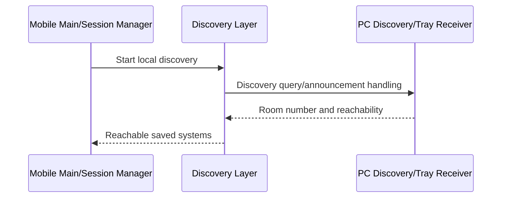
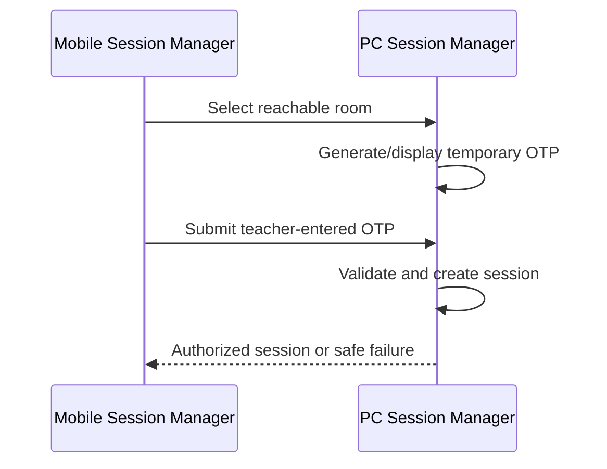

# Air Mouse for College Teaching — Implementation-Oriented Design

## 1. Purpose and Scope

`DESIGN.md` translates the product architecture and feature specifications into a practical component-level design. It explains responsibility boundaries, internal interactions, runtime states, persistence, safety hooks, and testability for the mobile controller and PC receiver.

It covers logical implementation design, not source code or a chosen technology stack. It does not replace `ARCHITECTURE.md` (system-level architecture), `API_PROTOCOL.md` (communication contract), `UI_UX.md` (detailed interface design), or feature-specific documents. Technology/framework/library/protocol/port/database/platform API decisions remain **TBD** unless separately approved.

## 2. Design Principles

- Simple practical implementation suitable for a college project.
- Clear responsibility separation between mobile, PC, and platform-specific adapters.
- Mobile-first teacher experience with frequent actions immediately available.
- Low-latency control path for cursor, pointer, and teaching commands.
- Reliable local Wi-Fi communication with graceful recovery.
- Security by default: authorization before privileged PC action.
- Minimal background PC/mobile resource usage when features are idle.
- Platform abstraction where possible.
- Independently testable components.
- Graceful failure, truthful state, and safe recovery.

## 3. High-Level Component Design

| Component | Side | Responsibility | Depends On | Notes |
|---|---|---|---|---|
| Main Screen Controller | Mobile | Teaching controls, room/status, feature entry states | Session, feature controllers | Advanced settings stay under three-dot menu. |
| Room/System Manager | Mobile | Saved room registration and selection | Pairing, discovery | Room number is teacher-facing identity. |
| Discovery Controller | Mobile/PC | Discover/announce reachable systems | Local network abstraction | Discovery mechanism is TBD. |
| Session Manager | Mobile/PC | OTP lifecycle, authorization, connection state | Network abstraction | Gates privileged features. |
| IMU Controller | Mobile | Sensor processing to cursor delta | Calibration, settings, session | Details in `IMU.md`. |
| Trackpad Controller | Mobile | Touch gestures to mouse events | Settings, session | Details in `MOUSE.md`. |
| Presentation Controller | Mobile/PC | Semantic command request and local execution | Session, PC adapter | Details in `PRESENTATION.md`. |
| Laser Controller/Renderer | Mobile/PC | Pointer state/update and PC display | Session, renderer | Rendering technology TBD. |
| File Transfer Controller/Service | Mobile/PC | Authorized transfer lifecycle/data handling | Session, storage boundary | No persistent transfer history. |
| Screen Hosting Controller/Receiver | Mobile/PC | Capture/encode/stream and decode/display | Session, stream path | Streaming technology TBD. |
| Custom Command Controller/Executor | Mobile/PC | Semantic command request and allowlisted action | Session, PC allowlist | No arbitrary shell execution. |
| Tray/Notification Manager | PC | Background operation, compact status/feedback | PC runtime/status | Remains unobtrusive. |
| Platform Adapters | PC | OS mouse/presentation/volume/window/display actions | Validated PC engines | Platform integration is TBD. |

## 4. Mobile Application Design

### 4.1 Main Screen Controller

The Main Screen Controller presents connected room/system status, Gyro Mouse, Trackpad, Laser Pointer, Calibrate, Presentation Controls, Share File, Screen Hosting, and Custom Commands. It subscribes to session and feature state, enables controls only when authorized, and exposes active/pending/failed states.

Frequently used teaching controls remain direct. Advanced mouse, IMU, systems, hosting, transfer, command, security, and application settings remain under the three-dot menu. Presentation Controls must not move into advanced settings.

### 4.2 Connection and Session Manager

This component coordinates discovery, room selection, temporary OTP input, authorized session creation, health monitoring, explicit disconnect, safe reconnect, session expiry, unavailable-system handling, and status events.

It is the mobile authorization gate: feature controllers may prepare UI while disconnected but cannot send privileged control/transfer/stream requests until session is authorized. Exact reconnect retention/re-authentication policy is **TBD** and follows `PAIRING.md`.

### 4.3 Pairing/Registration Component

The pairing component scans QR, extracts only room number, validates/saves room registration, and handles duplicate/conflicting saved-room registration. It does not create an authorized session. Later discovery and OTP authentication remain required.

QR is room identification/registration, not authentication. Room number is visible to teachers; implementation-level system identity remains opaque where needed.

### 4.4 IMU/Gyro Controller

Logical flow:

```text
Sensor input → preprocessing → calibration/bias compensation → filtering
→ orientation/motion calculation → cursor delta → sensitivity/acceleration
→ authorized command transmission
```

The controller owns sensor lifecycle, current calibration use, active/paused state, and safe stop on sensor/session failure. Detailed algorithms, coordinate conventions, calibration, filtering, drift, and stationary behavior belong in `IMU.md`.

### 4.5 Trackpad Controller

Trackpad Controller converts touch movement, tap, double tap, two-finger tap, vertical/horizontal scrolling, and tap/hold drag into semantic mouse events. It applies configured sensitivity/acceleration and resolves gesture conflicts before transmission.

On disconnect or gesture cancellation, it clears local gesture state and requests safe PC-side drag release behavior where applicable. Detailed user behavior is in `MOUSE.md`.

### 4.6 Presentation Controller

Presentation Controller sends semantic actions: `NEXT_SLIDE`, `PREVIOUS_SLIDE`, `START_PRESENTATION`, `END_PRESENTATION`, `BLANK_SCREEN`, `VOLUME_UP`, `VOLUME_DOWN`, `MUTE`, and `PLAY_PAUSE`.

It does not send arbitrary keyboard shortcuts or shell commands. Discrete requests use request/result state to avoid duplicate execution. PC maps semantic intent to local capability as defined in `PRESENTATION.md`.

### 4.7 Laser Pointer Controller

The controller owns start/stop state, low-latency pointer position updates, active UI indication, and disconnect cleanup. It sends pointer intent through authorized session; PC renderer owns display. Coordinate/scaling and rendering technology are **TBD**.

### 4.8 File Transfer Controller

This component manages selection, upload/download request, progress, cancellation, completion, interruption, and safe user errors. It creates active transfer state but never persistent transfer history. File data is separated from normal control messages. Destination/storage/path validation is enforced by PC service; requirements are in `FILE_SHARING.md`.

### 4.9 Screen Hosting Controller

The controller starts/stops hosting, requests authorized stream lifecycle, coordinates screen capture, encoding, stream transmission, rotation, quality/FPS preferences, and recovery UI. It uses streaming-oriented path rather than ordinary request/response controls. Capture/stream technology is **TBD**; behavior is in `SCREEN_MIRRORING.md`.

### 4.10 Custom Command Controller

This component displays enabled command definitions, sends semantic command ID with permitted parameters, tracks pending/result state, and shows success/failure. PC allowlist remains authoritative. It never exposes arbitrary shell, terminal, script, or executable-path input. See `CUSTOM_COMMANDS.md`.

## 5. PC Receiver Design

### 5.1 System Tray / Background Receiver

The receiver starts/runs in background where appropriate, maintains local availability, exposes compact tray UI, and sends compact notifications. It must remain unobtrusive while presentations run. Its tray panel shows room, connection/device status, mouse/presentation/hosting/transfer state, disconnect, and settings.

### 5.2 First-Time Setup

First-time setup collects room number, validates/configures it, generates QR containing only room number, displays QR, and persists room configuration locally. Storage mechanism is **TBD**.

### 5.3 Discovery Service

PC conceptually announces availability on local network and responds to discovery using room number. It handles network changes, availability lifecycle, multiple PCs, and duplicate room-number detection. Discovery technology/protocol is **TBD**; duplicate numbers must not silently select a receiver.

### 5.4 Authentication and Session Manager

PC Session Manager generates temporary OTP, applies expiration/attempt policy, validates OTP, creates/terminates session, validates every privileged request, and invalidates stale/replayed/expired contexts. It owns session cleanup after disconnect/restart/network loss. OTP/security specifics are **TBD** but must follow `PAIRING.md`, `SECURITY.md`, and `API_PROTOCOL.md`.

### 5.5 Input Control Engine

Input Engine accepts validated semantic cursor deltas, clicks, drag lifecycle, scroll, and mouse pause intent, then calls platform abstraction for OS execution. It does not trust raw mobile input without current authorization and safe state checks. Platform-specific mouse execution is TBD.

### 5.6 Presentation/Media Control Engine

This engine validates semantic presentation/media command and delegates to PC platform/application adapter. It owns capability/result reporting and avoids requiring mobile knowledge of presentation application. Focus/application-selection integration is **TBD**.

### 5.7 Laser Pointer Renderer

Renderer receives validated pointer lifecycle/position and displays classroom-visible overlay/pointer. It hides pointer on stop, session end, failure, or receiver cleanup. Graphics technology is **TBD**.

### 5.8 File Transfer Service

Service validates authorized transfer request, selected/allowed source or configured destination, filename/path safety, storage/permission conditions, progress, cancellation, failure, and cleanup. It never permits destination escape or arbitrary filesystem access. It deletes temporary active state after outcome and maintains no transfer history.

### 5.9 Screen Hosting Receiver

Receiver validates stream authorization, receives screen stream, decodes, displays, handles fullscreen/orientation/quality state, and clears display state after stop/failure/session end. Decode/display/stream technology is **TBD**.

### 5.10 Custom Command Executor

Executor validates session, command ID, allowlist, enabled state, permitted parameters, optional confirmation, and approved local action mapping. It returns safe result/error state. Arbitrary shell/terminal execution is not enabled by default.

## 6. Component Interaction

### App startup and discovery



### OTP authentication



### Feature flows

- **Gyro movement:** Sensor → IMU Controller → processed cursor delta → session/network layer → PC Session validation → Input Engine → platform OS cursor adapter.
- **Trackpad click:** Touch → gesture recognition → semantic click → PC validation → Input Engine → OS adapter.
- **Presentation command:** Main screen → Presentation Controller → semantic request → PC validation → Presentation Engine → platform/application adapter → result.
- **Laser movement:** Mobile Laser Controller → pointer update → PC validation → Laser Renderer.
- **File upload/download:** selection → transfer request/validation → dedicated transfer data path → progress/outcome → temporary-state cleanup.
- **Screen hosting:** start request → PC authorization → mobile capture/encode → streaming path → PC decode/display → status/stop/recovery.
- **Custom command:** selection → semantic ID request → PC validation/allowlist → approved action adapter → result.
- **Disconnect/reconnect:** Session Manager terminates/suspends features, clears temporary states, then rediscovery/re-authenticates under policy.

## 7. State Management

### Connection/session states

```text
Disconnected → Discovering → System Selected → Waiting for OTP → Authenticating → Connected
Connected → Reconnecting → Connected or Failed/Disconnected
Connected → Session Expired/Failed → Disconnected or authentication flow
```

### Screen Hosting states

```text
Stopped → Starting → Streaming → Stopping → Stopped
Streaming → Reconnecting → Streaming or Failed → Stopped
```

### File transfer states

```text
Idle → Preparing → Transferring → Completed
Transferring → Cancelling → Cancelled/Idle
Transferring → Paused/Interrupted → Retry or Failed
```

### Mouse states

```text
Idle → Active → Paused/Locked → Active
Idle/Active → Calibrating → Active or Calibration Failed
```

Valid transitions are controlled by owning controller and session state. A disconnected/invalid session prevents active control, transfer, command, and stream states from remaining operational.

## 8. Event and Data Flow

| Flow | Event path |
|---|---|
| Gyro | Phone Sensor → IMU Controller → Motion Processing → Mouse Command → Network Layer → PC Session → Input Engine → OS Cursor. |
| Trackpad | Touch Input → Gesture Controller → Mouse Event → PC Session → Input Engine → OS Mouse action. |
| Presentation | UI action → semantic command → PC validation → Presentation Engine → OS/application adapter → result event. |
| Pointer | Pointer input → Laser Controller → low-latency update → PC validation → Renderer. |
| File transfer | File selection → transfer control request → authorization/metadata validation → transfer data path → progress/outcome. |
| Screen stream | Start request → session validation → capture/encode → stream path → decode/display → status events. |
| Custom command | Command selection → command ID request → allowlist/parameter validation → approved action → result. |

## 9. Concurrency and Performance Design

Components avoid blocking UI/control responsiveness with slow operations. Sensor sampling, control delivery, file transfer, screen streaming, decoding, PC OS actions, and UI updates must be logically separable.

- Current movement/pointer state takes priority over retransmitting obsolete movement.
- File transfer must not block cursor/presentation control.
- Screen streaming uses distinct traffic path and adapts/degrades rather than making controls unusable.
- PC background receiver minimizes work when idle.
- UI receives concise state updates rather than heavy continuous processing.
- Exact threading, scheduling, queues, throttling, and backpressure mechanisms are **TBD**.

## 10. Platform Abstraction

Platform-specific PC behavior must be isolated behind conceptual adapters/interfaces for mouse control, keyboard/presentation behavior, volume/media control, application/window interaction, laser rendering, screen display/fullscreen, filesystem access, and launch of approved Custom Command actions.

Networking, session validation, feature business logic, and mobile semantic commands must not contain platform-specific implementation details. This keeps OS-specific code from leaking into protocol/security logic. Exact adapter form is **TBD**.

## 11. Configuration and Persistence

Persist minimally using lightweight local configuration unless a different mechanism is justified; exact storage mechanism is **TBD**.

| Category | Side | Persistence |
|---|---|---|
| Configured room number | PC | Persistent |
| Registered/saved rooms | Mobile | Persistent |
| UI, theme, notification preferences | Mobile/PC | Persistent |
| IMU calibration and mouse settings | Mobile | Persistent while valid |
| Presentation preferences/capabilities | PC/mobile where needed | Persistent where applicable |
| PC transfer destination | PC | Persistent |
| Custom Command definitions/allowlist | PC | Persistent |
| Screen hosting quality/display preferences | Mobile/PC | Persistent where applicable |
| OTP, active session, transfer, stream, heartbeat | Both | Temporary only |

No persistent file-transfer history, screen recording, or stored screen frames.

## 12. Error and Recovery Hooks

Components report errors at the earliest safe boundary:

- Session/Network Manager: network loss, authentication/session failure, receiver unavailable.
- IMU/Trackpad: sensor/input/calibration/gesture failure and safe input stop.
- PC engines: invalid/unsupported command, OS execution failure, renderer failure.
- File Transfer: validation, storage/path, interruption, cancellation, partial cleanup.
- Screen Hosting: capture/encoder/network/decoder/display/recovery failure.

Each reports normalized feature error to UI/notification/logging layer. Detailed codes, severity, messages, and recovery policy are authoritative in `ERROR_HANDLING.md`.

## 13. Security Boundaries

```text
Mobile App → Network → PC Receiver → OS-level Actions
```

PC treats mobile input as untrusted until session authentication succeeds, request/session context is validated, parameters are validated, and requested action is allowed. This applies to cursor input, presentation, files, streams, and Custom Commands.

QR only registers room identity. OTP establishes session. PC allowlist controls Custom Commands. File destinations and action paths remain restricted. Detailed rules are in `SECURITY.md` and `API_PROTOCOL.md`.

## 14. Logging and Diagnostics

Conceptually log connection events, authentication outcomes without OTP values, feature start/stop, safe error codes, file-transfer/Screen Hosting failure categories, and Custom Command validation/execution result.

Do not log OTPs, credentials/session secrets, screen frames/content, unnecessary personal information, or unnecessary sensitive file/path data. Retention/export/storage is **TBD** and follows `ERROR_HANDLING.md`/`SECURITY.md`.

## 15. Testability

Design controllers around replaceable dependencies so they can be evaluated independently:

- Mock sensor input for IMU/calibration/filtering/state.
- Mock network/session transport for discovery/auth/reconnect/protocol outcomes.
- Mock PC OS input adapter for mouse/presentation actions.
- Mock file transfer data path/storage boundary.
- Mock screen capture/stream/decode/display lifecycle.
- Mock Custom Command allowlist/executor.

Feature controllers should consume logical events/interfaces rather than directly embedding platform/network implementation. No test code is defined here.

## 16. Performance and Resource Considerations

Prioritize low-latency cursor/pointer and presentation control, efficient sensor processing, small control payloads, separate file/stream paths, hardware acceleration where available for streaming, acceptable mobile battery use, and low idle PC tray usage.

Avoid unnecessary polling, continuous discovery, heavy buffering, or persistent work when feature/session is inactive. Numerical targets and hardware-specific choices are **TBD** and validated through `TESTING.md`.

## 17. Design Decisions and TBD Items

| Decision | Current Direction | Status | Reason/Notes |
|---|---|---|---|
| System topology | Direct local mobile → Wi-Fi → PC receiver | Confirmed | No intermediary hardware/cloud needed for normal use. |
| Teacher identity | Room number | Confirmed | User-facing classroom identifier. |
| QR payload | Room number only | Confirmed | Registration, not authentication. |
| Authentication | Temporary PC-displayed OTP | Confirmed | Establishes authorized session. |
| Technology stack | Not selected | TBD | Choose based on supported platforms, maintainability, prototype feasibility. |
| Discovery mechanism | Local-network discovery | TBD | Choose for college network compatibility and low setup burden. |
| Control transport | Low-latency authorized control path | TBD | Choose for responsiveness, duplicate/stale safety. |
| Screen streaming | Capture/encode/stream/decode/display | TBD | Choose codec/transport by latency, capability, resource use. |
| OS integration | Platform adapter boundary | TBD | Choose per supported PC environment. |
| Laser rendering | PC-side renderer | TBD | Choose for visibility/low latency/platform support. |
| Persistence | Lightweight local configuration | TBD | Must support minimal local data, no required database/cloud. |

## 18. Cross-Document Consistency

Authoritative documents:

- `PRD.md` → product requirements.
- `FEATURES.md` → feature scope.
- `ARCHITECTURE.md` → system architecture.
- `UI_UX.md` → interface/visual design.
- `PAIRING.md` → pairing flow.
- `MOUSE.md` → mouse behavior.
- `IMU.md` → IMU processing/calibration.
- `PRESENTATION.md` → presentation controls.
- `SCREEN_MIRRORING.md` → screen hosting.
- `FILE_SHARING.md` → file transfer.
- `CUSTOM_COMMANDS.md` → custom commands.
- `NETWORK.md` → networking.
- `SECURITY.md` → security.
- `API_PROTOCOL.md` → communication contracts.
- `DATA_MODEL.md` → logical data structures.
- `ERROR_HANDLING.md` → error model.
- `TESTING.md` → testing.
- `DEVELOPMENT_PHASES.md` → development sequence.
- `DESIGN.md` → implementation-oriented component design.

## 19. Design Summary

Air Mouse consists of a mobile app that turns teacher actions, touch, and sensor input into authorized semantic control/stream/transfer requests, and a background PC receiver that validates each request before translating it into approved local PC behavior. Session management and PC-side validation provide the security boundary; separate control, transfer, and streaming paths preserve classroom responsiveness. Platform-specific PC functionality remains behind adapters, while shared state, error, configuration, and testability rules keep the design practical, modular, and suitable for incremental college-project development.
