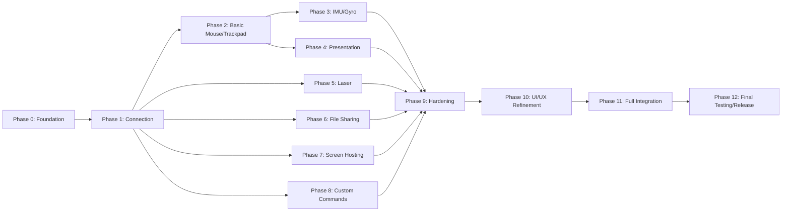

# Air Mouse for College Teaching — Development Phases

## 1. Development Philosophy

Build Air Mouse incrementally from a demonstrable local phone-to-PC prototype into a complete classroom-ready system.

- Build incrementally and validate each phase before expanding scope.
- Validate mobile ↔ PC connection early.
- Keep every phase demonstrable on real devices where possible.
- Implement core teaching controls before advanced features.
- Avoid premature optimization; use testing to guide tuning.
- Avoid unnecessary cloud infrastructure.
- Do not add ESP32, Arduino, Bluetooth controllers, or intermediary hardware.
- Keep undecided implementation choices marked **TBD**.
- Prefer a working end-to-end prototype over simultaneous unfinished feature work.

No technology stack, framework, transport, library, database, or deployment approach is selected by this roadmap.

## 2. Phase 0 — Project Foundation

### Scope

- Establish repository/project structure.
- Create mobile application foundation.
- Create PC receiver foundation.
- Add basic documentation structure and references to existing specifications.
- Prepare development environment and initial configuration approach.
- Create basic mobile UI shell.
- Create basic PC background/system-tray behavior shell.
- Define minimal local settings/configuration placeholder behavior.

### Demonstration

Mobile app and PC receiver start successfully. PC can run/minimize to system tray. Mobile shows an initial Air Mouse shell. No working connection is required yet.

### Exit Criteria

- [ ] Mobile and PC projects start successfully.
- [ ] Basic application structure exists.
- [ ] PC receiver has basic system-tray/background behavior.
- [ ] Mobile has basic UI shell.
- [ ] Existing project documentation is accessible to development work.

## 3. Phase 1 — Mobile ↔ PC Connection

### Scope

Implement the smallest secure, working local communication path:

- PC room-number setup.
- QR generation containing room number only.
- Mobile QR scanning and saved-room registration.
- Local-network discovery.
- Room selection.
- Temporary OTP display on PC.
- OTP entry/validation.
- Authorized session establishment.
- Explicit session termination/disconnect.

### Demonstration

Teacher scans/uses a saved room, discovers a reachable PC, enters PC-displayed temporary OTP, establishes an authorized session, sees connected status, and disconnects.

### Exit Criteria

- [ ] Teacher can identify a classroom PC by room number.
- [ ] QR contains room number only and is not authentication.
- [ ] Teacher can authenticate with temporary OTP.
- [ ] Authorized session is established only after valid OTP.
- [ ] Teacher can disconnect and saved room remains registered.
- [ ] Unauthenticated device cannot issue privileged controls.

## 4. Phase 2 — Basic Mouse and Trackpad

### Scope

Implement simple working PC cursor control before advanced IMU processing:

- Basic relative cursor movement.
- Left click.
- Right click.
- Scroll.
- Connection/status indication.
- Mobile Trackpad interface.
- Basic drag support where practical.

### Demonstration

Teacher connects through Phase 1 session and uses phone Trackpad to move PC cursor, click, right-click, scroll, and perform basic drag behavior.

### Exit Criteria

- [ ] Teacher can reliably control PC cursor from phone.
- [ ] Trackpad movement/click/scroll use authorized session.
- [ ] Connection loss safely stops input.
- [ ] PC is not left in unintended drag/click state after interruption.

## 5. Phase 3 — IMU/Gyro Mouse

### Scope

Implement Gyro Air Mouse according to `IMU.md` and `MOUSE.md`:

- Gyroscope/IMU input.
- XY, XZ, YZ axis modes.
- Independent axis inversion.
- Individual and overall sensitivity.
- Dead zone.
- Filtering.
- Drift compensation.
- Stationary detection.
- Calibration from main screen.
- Recalibration and reset.
- Optional haptic feedback.
- Mouse pause/lock.

### Demonstration

Teacher calibrates phone and controls PC cursor through phone motion, then adjusts axes/sensitivity and pauses mouse safely.

### Exit Criteria

- [ ] Gyro Mouse provides usable stable cursor control.
- [ ] Small intentional movement remains possible.
- [ ] Stationary phone does not cause excessive jitter/drift.
- [ ] Calibration, recalibration, and reset work.
- [ ] Trackpad remains available as fallback when sensor unavailable.

Final numeric tuning is not required before real-device testing. Thresholds/defaults remain **TBD** until measured.

## 6. Phase 4 — Presentation Controls

### Scope

Implement main-screen semantic presentation/media controls:

- Next Slide.
- Previous Slide.
- Start Presentation.
- End Presentation.
- Black/Blank Screen.
- Volume Up/Down.
- Mute.
- Play/Pause.

Use semantic commands, not arbitrary keyboard, shell, or terminal commands. PC maps semantic intent to supported local behavior.

### Demonstration

Teacher controls a supported presentation/media context from phone without opening advanced settings or a persistent PC receiver window.

### Exit Criteria

- [ ] Core presentation controls work reliably in supported PC environment/application context.
- [ ] Commands require authorized session.
- [ ] Single taps do not create unnecessary duplicate action.
- [ ] Unsupported/unavailable actions return clear feedback.

## 7. Phase 5 — Laser Pointer

### Scope

- Start/stop laser pointer.
- Low-latency pointer movement.
- PC-side pointer rendering.
- Active status indication.
- Session/disconnect cleanup.

### Demonstration

Teacher starts pointer from main screen, moves it while teaching, and stops it. Pointer safely hides when session ends.

### Exit Criteria

- [ ] Phone can act as responsive classroom laser pointer.
- [ ] PC pointer is visible and stops/hides on disconnect/session termination.
- [ ] Renderer/pointer failures are shown clearly.

## 8. Phase 6 — File Sharing

### Scope

- Phone → PC transfer.
- PC → Phone transfer.
- File selection.
- Transfer progress/status.
- Cancellation.
- Completion/error feedback.
- Configurable PC download/receive location.
- Safe path/filename handling.
- Authorized-session enforcement.
- No persistent transfer history.

### Demonstration

Teacher transfers selected files in either direction during authorized session and sees progress/cancel/completion states.

### Exit Criteria

- [ ] Files transfer reliably in both directions during authenticated session.
- [ ] PC destination is configurable and path-safe.
- [ ] Interrupted/cancelled transfer is never reported complete.
- [ ] No persistent file-transfer history is implemented.

## 9. Phase 7 — Screen Hosting

### Scope

Implement real-time mobile mirroring:

```text
Mobile capture → encode → Wi-Fi → PC decode → display
```

Include:

- Start/stop from mobile main screen.
- Full mobile-screen mirroring.
- Portrait/landscape and rotation.
- PC fullscreen where supported.
- Quality/FPS controls where practical.
- Low-latency behavior.
- Reconnection/error handling.
- Separate stream traffic from normal control traffic.
- Hardware acceleration where available; fallback/limitation behavior where not.

### Demonstration

Teacher starts hosting, continues using phone, sees full phone screen on PC, rotates phone, uses fullscreen if supported, and stops hosting.

### Exit Criteria

- [ ] Teacher can mirror full phone screen to classroom PC while using phone normally.
- [ ] Stream start/stop, orientation, display, and failure state are clear.
- [ ] Streaming does not use ordinary mouse/presentation control path.
- [ ] PC does not remain falsely active after stop/failure/session end.

## 10. Phase 8 — Custom Commands

### Scope

- Custom command creation.
- Editing.
- Enable/disable.
- Deletion.
- Optional reordering where useful.
- Execution and result/error feedback.
- PC-side allowlist validation.
- Examples: Open Calculator, Open Browser, Open Teaching Folder.

Do not implement unrestricted arbitrary shell/terminal execution, scripts, or arbitrary executable paths.

### Demonstration

Teacher manages approved command definitions in advanced settings and executes enabled command from mobile main-screen Custom Commands entry.

### Exit Criteria

- [ ] Teacher-defined approved actions execute safely from phone.
- [ ] PC validates command ID, allowlist, state, and permitted parameters.
- [ ] Unknown/disabled/unauthorized commands are rejected.
- [ ] Arbitrary shell execution is unavailable by default.

## 11. Phase 9 — Reliability and Security Hardening

### Scope

Integrate and test requirements from `SECURITY.md`, `ERROR_HANDLING.md`, and `TESTING.md`:

- Authentication security and OTP failure behavior.
- Session expiration/invalidation.
- Reconnection and network-change behavior.
- Duplicate/stale request handling.
- Command validation and Custom Command safety.
- File/path validation and incomplete transfer cleanup.
- Screen-stream authorization and cleanup.
- Error status/messages/recovery.
- PC/mobile restarts and network failures.

### Demonstration

Induce realistic failures—wrong OTP, disconnect, PC restart, sensor loss, interrupted transfer, stream failure, duplicate command—and verify safe, understandable behavior.

### Exit Criteria

- [ ] Major failure scenarios behave safely and predictably.
- [ ] Unauthorized access attempts are rejected.
- [ ] No stale input/command/stream/transfer state remains active after failure.
- [ ] Teacher receives useful non-sensitive feedback.

## 12. Phase 10 — UI/UX Refinement

### Scope

Refine mobile and PC interfaces according to `UI_UX.md`:

- Clean glassmorphism design.
- Clear hierarchy and readable contrast.
- Main screen contains frequent controls.
- Advanced configuration is under three-dot menu.
- Presentation Controls remain directly accessible.
- Clear room/connection status.
- Clear active-feature states.
- Light/dark themes.
- Smooth restrained animation.
- Accessible touch targets.
- Unobtrusive PC system-tray operation.

### Demonstration

A teacher performs regular lecture flow with minimal navigation and no technical network knowledge.

### Exit Criteria

- [ ] Teacher can use system without understanding internal architecture.
- [ ] Main screen remains minimal and teaching-focused.
- [ ] Glassmorphism remains readable in light/dark themes.
- [ ] PC remains unobtrusive during teaching.

## 13. Phase 11 — Full Integration

### Scope

Combine and validate all major features:

- Pairing/authentication.
- Gyro Mouse and Trackpad.
- Presentation/media controls.
- Laser Pointer.
- File sharing.
- Screen Hosting.
- Custom Commands.
- Error handling/security/settings.

Test individual features and simultaneous use, including mouse during transfer, presentation during hosting, and disconnect during active operations.

### Demonstration

Run complete classroom lecture workflow from connect through disconnect, including at least one core control mode and relevant advanced features.

### Exit Criteria

- [ ] Complete end-to-end classroom workflow works reliably.
- [ ] Feature interaction does not create unacceptable control/session errors.
- [ ] All status/error states remain understandable.

## 14. Phase 12 — Final Testing and Release

### Scope

Perform:

- Regression testing.
- End-to-end classroom testing.
- Security testing.
- Network/reliability testing.
- Performance testing.
- UI/UX testing.
- Device compatibility testing.
- Long-duration classroom testing.

Fix critical defects before release. Prepare:

- User documentation.
- Setup instructions.
- Troubleshooting guidance.
- Known limitations.
- Final release build/package approach, **TBD**.

### Exit Criteria

- [ ] Critical defects are fixed or explicitly documented as release blockers/limitations.
- [ ] Regression and classroom acceptance tests pass for supported environment.
- [ ] User setup/troubleshooting documentation is complete.
- [ ] Final release artifact is prepared using selected technology/deployment approach.

## 15. Phase Dependencies



Dependencies show the recommended implementation order, not a prohibition on later-feature experimentation. For example, Screen Hosting feasibility can be explored early, but it should not delay the basic secure connection and teaching-control prototype.

## 16. Definition of Done

A feature is generally Done when it has:

- Functional implementation.
- Required mobile/PC integration.
- Basic error handling and user-visible state.
- Security validation where applicable.
- Manual test coverage and relevant regression coverage.
- UI state handling for loading/active/failure/stopped conditions.
- Documentation update.
- No known critical defect.

A feature is not Done merely because a happy-path demo works once.

## 17. MVP Definition

### MVP scope

The smallest useful MVP focuses on basic classroom remote control:

- PC room-number setup and QR registration containing room number only.
- Local Wi-Fi discovery and temporary OTP authentication.
- Authorized session establishment/disconnect.
- Basic Trackpad/cursor movement, click, right click, and scroll.
- Core presentation controls: Previous, Next, Start, End, and basic media/system controls where supported.
- Basic connection status and safe disconnect handling.
- PC system-tray/background receiver foundation.

### Later features

The following are outside MVP and follow after core workflow is stable:

- Advanced Gyro/IMU calibration/filtering/drift behavior.
- Laser Pointer.
- File Sharing.
- Screen Hosting.
- Custom Commands.
- Full UI polish and broad hardening beyond MVP safety requirements.

## 18. Future Enhancements

These are **Future/TBD**, not current requirements:

- Additional classroom/presentation integrations.
- More advanced gestures or input modes.
- Better adaptive networking and quality adaptation.
- Additional approved Custom Command capabilities under separate security design.
- Broader mobile/desktop platform support.
- Advanced diagnostics/analytics with privacy review.
- More accessibility and localization options.
- Expanded presentation/media capability detection.

## 19. Roadmap Acceptance Criteria

- [ ] The roadmap identifies Foundation and secure Connection as first implementation priorities.
- [ ] A working end-to-end prototype is achieved before advanced features.
- [ ] Each phase has practical scope, demonstration, and exit criteria.
- [ ] Dependencies between core, advanced, hardening, refinement, integration, and release are clear.
- [ ] MVP scope is explicitly separated from later advanced features.
- [ ] Security/reliability hardening is planned before release.
- [ ] Final testing and release preparation are defined.
- [ ] No arbitrary deadlines or unselected technology stack are invented.
- [ ] Future enhancements are clearly marked Future/TBD.
