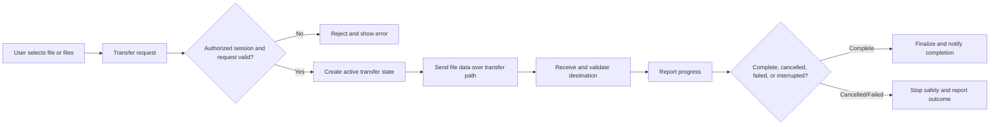

# Air Mouse for College Teaching — File Sharing Requirements

## 1. Purpose

File Sharing lets a teacher transfer files between a mobile phone and a classroom PC over the local Wi-Fi network. It supports both directions:

- Phone → PC
- PC → Phone

The mobile app exposes the feature through **Share File** on the main screen. By default, every transfer requires an authorized Air Mouse session. The feature is designed for practical classroom use: clear selection, visible progress, cancellation, understandable completion/error feedback, and safe PC-side file handling.

This document is technology-independent. It does not prescribe programming languages, frameworks, libraries, ports, protocols, databases, encryption libraries, or implementation code. Such choices are **TBD** and must remain consistent with `ARCHITECTURE.md`, `PAIRING.md`, `SECURITY.md`, and `API_PROTOCOL.md`.

## 2. Scope and Non-Goal

File Sharing transfers user-selected files between the phone and authorized classroom PC. It may support single-file transfer and multiple-file transfer where practical.

**No transfer history is included.** The project must not provide a user-facing list of previously transferred files or a transfer-history database. Temporary active-transfer state may exist only while needed to execute, report, cancel, or safely clean up an active transfer. It must not become permanent historical data unless explicitly required later.

## 3. Authorization Requirement

File transfer requires an active authorized Air Mouse session by default.

- Unauthenticated devices cannot upload or download files.
- A transfer request is associated with the active session.
- PC validates session authorization before accepting or sending a transfer.
- Session expiration, disconnect, invalid session, or authorization failure stops/rejects transfer safely.
- File sharing must not expose arbitrary PC filesystem access.

Pairing, OTP authentication, and session lifecycle are defined in `PAIRING.md`.

## 4. Phone → PC Flow

1. Teacher taps **Share File** in the mobile app.
2. Teacher selects one or more files on the phone.
3. Mobile presents selected files, destination context, and start action as appropriate.
4. Mobile sends a transfer request to the authorized PC.
5. PC validates active session, request, configured destination, file metadata, and available conditions.
6. On acceptance, transfer begins.
7. Mobile and PC show transfer state/progress as appropriate.
8. Teacher may cancel while the transfer is active.
9. Completion or failure is reported clearly on relevant devices.

The exact selection UI, request/acceptance mechanics, and message format are **TBD**. Ordinary successful transfer should not require unnecessary confirmation dialogs.

## 5. PC → Phone Flow

1. Teacher initiates a PC-to-phone transfer from the PC receiver interface where appropriate.
2. PC presents/selects the source file from allowed PC-side locations.
3. PC sends transfer request to the authorized mobile session.
4. Mobile presents incoming-transfer context and accepts as required.
5. Transfer begins.
6. Mobile and PC show transfer state/progress as appropriate.
7. Teacher may cancel while active.
8. Completion or failure is reported clearly on relevant devices.

The PC must access only user-selected files or files from explicitly allowed locations. It must not silently access unrelated files. Exact acceptance policy and UI are **TBD**.

## 6. Transfer Features

| Feature | Requirement |
|---|---|
| Single-file transfer | Supported in both directions. |
| Multiple-file transfer | Supported where practical; exact batching behavior is **TBD**. |
| Progress | Display percentage or equivalent meaningful progress indication for active transfers. |
| Status | Show selecting, preparing, transferring, completed, cancelled, failed, and connection-lost states. |
| Cancellation | Teacher can cancel active transfer; applicable side safely stops transfer. |
| Completion | Show concise success notification only after transfer is complete. |
| Failure | Show concise teacher-readable error and available recovery action. |
| Retry | Offer retry where conditions allow; exact automatic/manual retry policy is **TBD**. |
| Interrupted transfer | Mark incomplete/failed; never report it as successful completion. |

## 7. Transfer State Model

| State | Meaning and UX |
|---|---|
| Selecting file | User selects one or more source files. |
| Preparing transfer | Session/destination/request validation and preparation are underway. |
| Transferring | Data is active; show progress and Cancel. |
| Completed | Transfer finished successfully; show transient completion notification. |
| Cancelled | User/system stopped transfer; make clear that it was not completed. |
| Failed | Transfer could not finish; explain reason where possible and offer retry/return. |
| Connection lost | Transfer cannot continue because session/network/peer is unavailable; show recovery guidance. |

State must never imply completed when data is partial, cancelled, rejected, or interrupted.

## 8. Transfer Architecture

File transfers use a dedicated transfer path logically separate from low-latency mouse, laser, and presentation command messages.

Large file contents must not travel through ordinary mouse/presentation control messages because they can delay time-sensitive classroom controls and have different progress, interruption, and flow-control requirements.

Conceptual transfer information includes:

| Item | Purpose |
|---|---|
| Transfer ID | Identifies an active transfer and its status; format is **TBD**. |
| Source | Selected phone or PC source context. |
| Destination | Authorized recipient and configured/allowed destination context. |
| Filename | User-visible file name after validation/sanitization. |
| File size | Supports progress and capacity validation where available. |
| Transfer state | Selecting, preparing, transferring, completed, cancelled, failed, or interrupted. |
| Progress | Percentage or equivalent progress measure. |
| Completion | Explicit successful-finalization state. |
| Cancellation | Explicit request/result state. |
| Error | Teacher-readable failure category and recovery option. |

Exact message formats, transport, integrity verification, resume behavior, and protocol details are **TBD** and belong in `API_PROTOCOL.md`.

## 9. PC Destination Configuration

The PC has a configurable default download/receive directory for Phone → PC transfers. The receiver validates this location before and during transfer as needed.

| Condition | Required behavior |
|---|---|
| Invalid configured path | Do not start transfer; explain destination must be corrected. |
| Missing directory | Explain destination is unavailable; offer settings/retry where practical. |
| Permission error | Do not write file; show permission-related failure without technical stack trace. |
| Insufficient disk space | Reject/fail safely and state that PC storage is insufficient. |
| Duplicate filename/existing file | Apply defined safe conflict behavior; exact rename/replace/prompt policy is **TBD**. |
| Unsupported filename | Reject or safely normalize according to final policy; explain failure if rejected. |
| Path traversal attempt | Reject request; never allow destination to escape configured allowed directory. |

Received filenames and paths must not escape the configured destination directory. A received file name must never be treated as permission to write arbitrary PC paths.

## 10. PC File Access Boundaries

PC → Phone transfers use explicit user-selected source files or files from explicitly allowed locations where practical. The transfer system must not provide arbitrary remote browsing/access to the PC filesystem.

Distinguish user-selected files from automatically accessed files. Automatic access is not assumed; any future allowed-location behavior is **TBD** and must remain constrained, visible, and authorized.

## 11. Network Behavior

| Condition | Required behavior |
|---|---|
| Normal Wi-Fi transfer | Transfer proceeds with active progress/status feedback. |
| Weak/slow Wi-Fi | Continue when practical; progress reflects slower transfer; avoid misleading timeout/completion state. |
| Temporary network interruption | Mark transfer interrupted or recovering according to final policy; do not claim completion. |
| Complete disconnection | Stop safely, report connection loss, and clean up incomplete state. |
| PC unavailable | Reject/stop transfer; mobile shows PC unavailable. |
| Mobile unavailable | PC stops/marks transfer unavailable or failed safely. |
| Transfer timeout | Mark transfer failed/interrupted and provide retry guidance. Exact timeout is **TBD**. |
| Transfer cancellation | Stop active data transfer and report Cancelled, not Completed. |
| Partial/incomplete file | Never present as successfully transferred; cleanup/retention policy is **TBD**. |

Resume behavior after interruption is **TBD**. Until explicitly designed, the safe default is to report failure/interruption and allow the teacher to retry rather than assuming partial transfer can resume correctly.

## 12. Filename and Path Safety

Before writing on PC, validate destination and incoming filename. The system must:

- Restrict received data to configured/allowed destination boundaries.
- Prevent path traversal and path escape.
- Reject invalid or unsupported file names according to defined policy.
- Handle existing files safely rather than silently overwriting unless an explicit policy permits it.
- Avoid exposing arbitrary filesystem structure in mobile UI.
- Keep error messages teacher-readable without leaking unnecessary internal path or stack-trace detail.

Filename normalization rules, allowed character policy, extension policy, collision behavior, and cleanup behavior are **TBD**.

## 13. User Experience

File sharing is simple enough for classroom use. The main mobile entry is **Share File**. Active views show selected file name(s), target room/device context, transfer progress, transfer state, and Cancel where applicable.

Use concise feedback:

- “Preparing transfer…”
- “Sending [file name]…”
- “Receiving [file name]…”
- “Transfer complete.”
- “Transfer cancelled.”
- “Transfer failed: [clear reason].”
- “Connection lost. Transfer stopped.”

Do not expose protocol errors, raw paths, stack traces, ports, or other technical diagnostics in ordinary teacher UI. Do not add a transfer-history screen after completion.

## 14. Cancellation and Retry

Cancellation is available during active transfer. A cancellation request must stop transfer as safely and promptly as practical, update both applicable sides, and result in Cancelled state rather than Completion.

Retry is offered after a recoverable failure where source/destination/session conditions still permit. Retry behavior is not automatic unless explicitly designed later; exact policy is **TBD**. A retry must start a valid new/renewed active transfer context and must not falsely reuse stale completion state.

## 15. Security Requirements

- File transfer requires an authorized active session by default.
- Unauthenticated devices cannot upload/download files.
- Requests are associated with active session authorization.
- PC validates session, request, filename, destination, and applicable access boundary before transfer.
- Directory traversal is prevented.
- Arbitrary filesystem access is not exposed.
- PC-side file selection is explicit/allowed-location constrained.
- Mobile cannot request arbitrary path reads/writes as a normal feature.
- Transfer authorization ends when session authorization ends.

Specific encryption, transport protection, file-integrity, malware scanning, or protocol details are **TBD**. This document does not require unsupported security tooling or a cloud service.

## 16. Error Handling

| Error | User-facing response |
|---|---|
| No authorized session | Explain that connection/authorization is required; offer reconnect. |
| PC unavailable | Explain PC cannot be reached; offer retry or return. |
| Mobile unavailable | Explain receiving phone is unavailable; stop/fail safely. |
| Invalid destination | Explain configured PC receive folder is unavailable/invalid; offer settings. |
| Missing directory | Explain destination folder is unavailable; offer retry/settings. |
| Permission failure | Explain PC cannot save/access selected location; offer destination correction. |
| Insufficient storage | Explain storage is insufficient; do not claim completion. |
| Duplicate filename | Show defined conflict resolution or explain conflict; final policy is **TBD**. |
| Invalid/unsupported filename | Explain file name cannot be accepted; allow selecting another file. |
| Path traversal attempt | Reject safely; show generic invalid destination/name message without security internals. |
| Timeout/interruption | Explain transfer stopped before completion; offer retry. |
| Cancellation | Confirm cancellation without claiming file was transferred. |
| Invalid session/unauthorized request | Reject and require authorized connection; do not reveal security internals. |

## 17. Testing Requirements

| Area | Required tests |
|---|---|
| Normal transfer | Successful Phone → PC and successful PC → Phone transfers. |
| File size | Small and large files. |
| Multiple files | Multiple-file selection/transfer where implemented. |
| Naming | Duplicate filename, existing file, invalid/unsupported filename. |
| Control | Cancelled transfer and retry behavior. |
| Network | Weak Wi-Fi, network interruption, complete disconnect, timeout. |
| Lifecycle | PC restart, mobile restart, PC/mobile unavailable during transfer. |
| Storage/destination | Insufficient storage, invalid destination, missing directory, permission failure. |
| Security | Path traversal attempt and unauthorized transfer attempt. |

Testing must confirm that cancelled, failed, and partial transfers are never represented as completed and that no persistent transfer history is created.

## 18. Relationship to Other Documents

- `ARCHITECTURE.md` defines communication-plane separation and major mobile/PC components.
- `PAIRING.md` defines discovery, OTP authentication, authorized sessions, and reconnect behavior.
- `SECURITY.md`, if present, defines broader security policy.
- `API_PROTOCOL.md`, if present, defines concrete transfer messages/protocol.
- `UI_UX.md` defines detailed UI visual behavior.
- `PRD.md` contains broader product requirements if present.

## 19. Acceptance Criteria

- [ ] Phone → PC transfer flow is defined and works through an authorized session.
- [ ] PC → Phone transfer flow is defined and works through an authorized session.
- [ ] Single-file transfer is supported.
- [ ] Multiple-file transfer is supported where practical or explicitly marked unsupported/TBD.
- [ ] Active transfers show progress percentage or equivalent, status, and completion/failure feedback.
- [ ] Teacher can cancel an active transfer.
- [ ] Cancelled or failed transfers are not reported as complete.
- [ ] Network interruption, complete disconnection, timeout, and peer unavailability are handled clearly.
- [ ] PC default receive/download location is configurable.
- [ ] Invalid paths, missing directories, permissions, storage limits, duplicate names, and unsupported names are handled safely.
- [ ] Path traversal and destination escape are prevented.
- [ ] Unauthenticated devices cannot transfer files.
- [ ] PC-side file access remains limited to explicit user selection or allowed locations.
- [ ] Large file data is separated from low-latency control commands.
- [ ] No user-facing or persistent file-transfer history is implemented.
