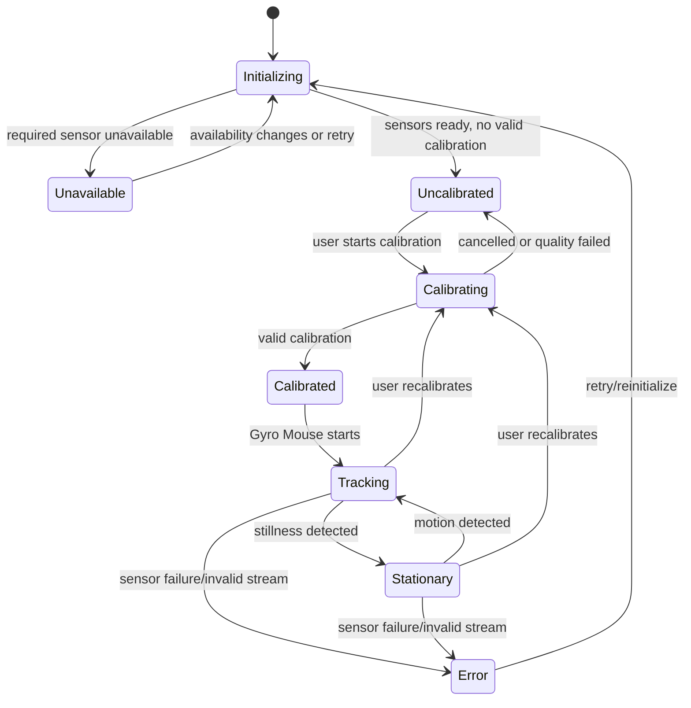

# Air Mouse for College Teaching — IMU Requirements

## 1. Purpose

Air Mouse uses mobile-phone motion sensors to control the cursor on a classroom PC. The conceptual Gyro Air Mouse pipeline is:

```text
Phone IMU
→ Sensor Sampling
→ Calibration
→ Bias Compensation
→ Noise Filtering
→ Stationary Detection
→ Axis Mapping
→ Axis Inversion
→ Sensitivity
→ Acceleration
→ Cursor Delta
→ Wi-Fi
→ PC Receiver
→ OS Cursor
```

The goal is a cursor that is responsive, smooth, stable, low-latency, accurate for small movements, and resistant to sensor noise and drift. This document defines IMU functional and technical requirements without prescribing implementation code, a sensor library, a protocol, or exact hardware.

## 2. Sensor Requirements

The implementation determines which motion sensors available on a phone provide the necessary data. Potential inputs include gyroscope, accelerometer, and other available motion/orientation sensors where useful. Phones must not be assumed to have identical hardware or sensor quality.

| Requirement | Behavior |
|---|---|
| Required data | Obtain motion data sufficient for configured Gyro Mouse operation; gyroscope is expected where Gyro Mouse requires it. Supporting accelerometer/orientation data is used only where useful. |
| Sampling | Request/process sensor updates at a rate suitable for responsive cursor control. Exact frequency is **TBD**. |
| Timestamping | Each processed sample conceptually includes a timestamp. |
| Availability detection | Detect unavailable/unsupported sensors before presenting Gyro Mouse as usable. |
| Initialization | Initialize required sensors when gyro operation begins or as final lifecycle design requires, **TBD**. |
| Shutdown | Stop or reduce sensor use when no longer needed, according to final lifecycle/battery policy. |

Unsupported devices must fail gracefully and leave Trackpad available where possible.

## 3. Coordinate System

The project requires a consistent coordinate convention, documented before production implementation.

| Coordinate frame | Meaning |
|---|---|
| Device coordinate system | Raw/native axes reported by phone sensors. |
| Application coordinate system | Normalized Air Mouse axis convention after any required conversion. |
| Cursor coordinate system | Relative PC cursor movement: horizontal delta x and vertical delta y. |

Define application X, Y, and Z axes, positive direction, units, and coordinate frame in the implementation specification. Raw device axes must not be assumed to map directly to cursor axes. If operating-system/device conventions vary, use a conversion layer from device coordinates to application coordinates. Exact convention and units are **TBD**.

## 4. Axis Mapping

Gyro Mouse supports selectable axis combinations: **XY**, **XZ**, and **YZ**. Axis mapping determines which two application motion axes contribute to cursor horizontal and vertical movement.

For each selected pair, one selected axis derives horizontal cursor movement and the other derives vertical cursor movement. Exact pair-to-horizontal/vertical direction may be configurable if necessary and is **TBD**. Mapping must remain independent of sensitivity and inversion settings so a teacher can change axis mode without resetting unrelated configuration.

## 5. Axis Inversion

Support independent inversion of X, Y, and Z.

| Axis | Example setting |
|---|---|
| X | Off |
| Y | On |
| Z | Off |

Inversion is a sign change applied after relevant axis selection and before final cursor movement generation. It affects only the selected axis signal and does not alter calibration, sensor sampling, or other axes.

## 6. Sensor Sampling

Each conceptual sensor sample contains sensor values and timestamp. Process samples in chronological order. Do not assume arrivals are perfectly periodic; calculations that depend on time account for actual elapsed time between samples.

If a timestamp is missing, invalid, or non-monotonic, safely reject or handle that sample according to final validation policy, **TBD**. Avoid using malformed samples to create uncontrolled cursor motion.

## 7. Calibration

Calibration is explicit and initiated from the mobile UI; it must not begin silently.

1. User presses **Calibrate**.
2. App instructs user to place the phone on a stable surface and keep it still.
3. Countdown begins.
4. Stationary samples are collected.
5. Bias/offset is estimated.
6. Calibration quality is evaluated.
7. Valid calibration data is stored.
8. User receives success or failure feedback.

The exact sample count, countdown duration, estimation method, and quality thresholds are **TBD**. Detailed user-facing calibration behavior is in `MOUSE.md`; this document defines the IMU data requirements.

## 8. Calibration Data

Conceptual calibration data may include gyroscope bias, accelerometer bias where used, sensor offsets, orientation/reference state where required, and calibration timestamp/version. Do not prescribe a storage format.

Valid calibration data persists across normal application restarts. OTPs and pairing credentials are unrelated to calibration and must not be treated as calibration data. The final persistence lifecycle and compatibility/version policy are **TBD**.

## 9. Calibration Quality

The system detects obviously poor calibration conditions, including phone movement during calibration, excessive sensor noise, unavailable sensor, insufficient samples, and invalid sensor readings.

If quality is unacceptable, do not silently save bad calibration data. Inform the user, retain the previous valid calibration where practical, and request retry. Exact quality thresholds and rejection rules are **TBD**.

## 10. Gyroscope Bias

A stationary gyroscope may report non-zero angular velocity. This gyroscope bias can accumulate into unintended cursor movement. Estimate and compensate for bias:

```text
Corrected gyro = Raw gyro − Estimated bias
```

The system may update bias dynamically only when doing so is safe, such as during verified stationary periods. Do not prescribe a particular estimation algorithm until testing justifies it.

## 11. Drift Compensation

Drift compensation reduces accumulated cursor movement caused by gyroscope bias, sensor noise, temperature/environmental changes, and long periods of use. Stationary detection may safely contribute to drift estimates.

Compensation must not continuously suppress intentional slow movement. If confidence in drift estimation is insufficient, favor stable, predictable behavior and provide recalibration rather than applying aggressive correction. Detailed algorithms are **TBD**.

## 12. Stationary Detection

Stationary detection determines when the phone is sufficiently still. Candidate signals include gyroscope magnitude, accelerometer variation, short-term sensor variance, and orientation stability.

Conceptually, sensor activity below suitable threshold for suitable duration indicates stationary state. When stationary, cursor drift should be minimized, bias estimation may update, and filtering may become more aggressive where appropriate. Exact thresholds, duration, and signal combination are **TBD**.

The transition between stationary and moving must avoid cursor jumps, abrupt loss of small intentional movement, and excessive delay.

## 13. Noise Filtering

Filtering balances stability and responsiveness. Possible approaches include low-pass filtering, exponential moving average, adaptive filtering, complementary filtering, Kalman filtering, or another appropriate method. A Kalman filter is not required merely for sophistication.

Choose the final approach using cursor stability, latency, CPU use, small-movement preservation, and practical testing. The final algorithm is **TBD**. Filtering must reduce high-frequency noise without making the cursor sluggish.

## 14. Dead Zone

Provide a small configurable dead zone to prevent insignificant sensor noise from moving the cursor.

- Values below the threshold may be treated as zero.
- Values above the threshold remain responsive.
- Threshold is configurable.
- Dead zone must not eliminate intentional micro-movements.

Trade-off: too small yields jitter; too large loses precision. Exact implementation is **TBD**.

## 15. Filtering vs. Dead Zone

| Mechanism | Purpose |
|---|---|
| Filtering | Smooths/reduces high-frequency sensor noise across changing input. |
| Dead Zone | Rejects values below a defined movement threshold. |

Both can be useful: filtering improves signal quality, while a dead zone suppresses residual insignificant motion. They are not identical operations and must not be treated as a single substitute for stable calibration and bias compensation.

## 16. Sensitivity

**Overall sensitivity** is a global multiplier affecting cursor response. **Axis sensitivity** is an independent multiplier for X, Y, and Z.

Conceptually:

```text
Cursor input = filtered sensor signal × axis sensitivity × overall sensitivity
```

Only selected axes affect current cursor output, but all axis settings can persist. Exact mathematical order and scaling are **TBD**, provided mapping, inversion, sensitivity, and acceleration remain independently configurable.

## 17. Cursor Acceleration

Optional configurable cursor acceleration permits slow physical movement to yield fine control and faster motion to yield larger cursor response. Acceleration must be smooth and avoid sudden jumps.

Expose acceleration strength; maximum response may be configured internally or exposed if justified. Exact curve and limits are **TBD**.

## 18. Time-Based Processing

The pipeline considers actual elapsed time between samples. Use timestamps rather than assuming a fixed interval whenever calculations depend on time, including integration, filtering, motion estimation, and drift analysis.

This avoids accumulating error from irregular sampling. Detailed handling of unusually long gaps, suspended-app periods, and timestamp anomalies is **TBD**, but such gaps must not create a large cursor jump.

## 19. Orientation Handling

Handle portrait, landscape, device rotation, and screen-orientation changes consistently. Cursor direction must not unexpectedly reverse merely because display orientation changed.

The exact orientation-reference implementation is **TBD**. The final design must define when orientation is sampled, whether rotation changes mapping, and how it avoids disrupting active pointer control.

## 20. Reference Orientation

The product may require a reference orientation. If used, establish it through calibration or an explicit reference action and interpret subsequent movement relative to it. If no persistent reference orientation is used, document how movement remains intuitive through orientation changes.

Do not select a final orientation algorithm without testing. The algorithm is **TBD**; the observable requirement is predictable cursor behavior with no unexpected reversals or jumps.

## 21. Cursor Movement Model

The output is a relative cursor delta x, y, not an arbitrary absolute screen coordinate. Conceptually, validated and corrected sensor motion is filtered, checked for stationary/drift handling, selected by axis mapping, inverted where enabled, scaled by sensitivities, and optionally accelerated to generate cursor delta.

The PC receiver converts authorized deltas into OS cursor motion. Input processing must preserve small intentional movement and constrain pathological jumps.

## 22. Low-Latency Requirements

Prioritize low latency throughout the IMU pipeline. Avoid unnecessary buffering, large processing windows, delays, and heavy computation. Filtering must not make the cursor feel sluggish.

Exact end-to-end latency target and measurement approach are **TBD** and must be set after prototype testing.

## 23. CPU and Battery Considerations

IMU processing must be efficient enough for prolonged classroom use. Balance CPU use, battery consumption, sensor sampling rate, processing frequency, and background behavior against responsiveness.

Avoid expensive algorithms where simpler processing gives adequate cursor quality. Exact power policy is **TBD**. When gyro mode is inactive, paused, or unavailable, avoid unnecessary sensor work where practical.

## 24. Sensor Failure

Handle gyroscope unavailable, accelerometer unavailable, sensor permission denied, initialization failure, sensor stream interruption, and invalid sensor values.

The app detects the failure, informs the user clearly, prevents uncontrolled/misleading cursor movement, and offers Trackpad when possible. Invalid values must not be transformed into cursor motion. Exact retry/reinitialization policy is **TBD**.

## 25. Recalibration

Support recalibration at any time. A successful recalibration replaces the previous calibration. If a new calibration fails, preserve the previous valid calibration where practical and clearly indicate that the new attempt did not apply.

Provide Reset Calibration. Reset behavior returns to defined uncalibrated/default state and must be clearly communicated. Exact reset policy is **TBD**.

## 26. IMU State Machine

Conceptual IMU states: Unavailable, Initializing, Uncalibrated, Calibrating, Calibrated, Tracking, Stationary, and Error.



Calibrated is a valid readiness state; Tracking and Stationary are active gyro-operation states. State representation in UI must not imply tracking when the sensor is unavailable or uncalibrated.

## 27. Processing Pipeline

| Stage | Purpose |
|---|---|
| Raw Sensor Data | Obtain available motion sensor values. |
| Validation | Reject/handle missing, malformed, or invalid readings safely. |
| Timestamping | Order samples and derive elapsed time. |
| Calibration/Bias Correction | Apply valid offsets/bias estimates. |
| Filtering | Reduce noise while preserving useful movement. |
| Stationary Detection | Identify stillness for stability and safe drift handling. |
| Drift Compensation | Reduce accumulated unwanted movement. |
| Axis Selection | Choose XY, XZ, or YZ input pair. |
| Axis Inversion | Apply configured sign changes. |
| Sensitivity | Apply selected axis and overall scaling. |
| Acceleration | Apply optional speed-dependent response. |
| Cursor Delta | Produce bounded relative x, y for authorized delivery. |

The exact ordering may be refined through testing if the stated purposes and user-facing behavior remain satisfied.

## 28. Parameter Configuration

### User-facing settings

- Axis mode: XY / XZ / YZ.
- X, Y, Z inversion.
- X, Y, Z sensitivity.
- Overall sensitivity.
- Acceleration.
- Dead zone.
- Filtering strength/type where appropriate to expose.
- Haptic feedback.

### Internal parameters

Internal filter coefficients, stationarity thresholds, bias-update controls, quality thresholds, safety bounds, and other expert parameters need not be exposed to teachers. Their final design is **TBD** and should be derived from testing.

## 29. Default Values

| Parameter | Purpose | User configurable? | Default |
|---|---|---:|---|
| Axis mode | Selects two axes for cursor mapping | Yes | TBD — determine through testing |
| X/Y/Z inversion | Reverses individual axis direction | Yes | TBD — determine through testing |
| X/Y/Z sensitivity | Tunes per-axis cursor response | Yes | TBD — determine through testing |
| Overall sensitivity | Tunes global response | Yes | TBD — determine through testing |
| Acceleration | Tunes speed-dependent response | Yes | TBD — determine through testing |
| Dead zone | Reduces insignificant movement | Yes | TBD — determine through testing |
| Filtering | Reduces sensor noise | Where exposed | TBD — determine through testing |
| Stationary detection | Supports stability/drift handling | Normally internal | TBD — determine through testing |
| Haptic feedback | Confirms meaningful events | Yes | TBD — determine through testing |

## 30. Testing Requirements

| Area | Required test cases |
|---|---|
| Calibration | Successful calibration; phone moved during calibration; high noise; insufficient samples; recalibration; reset. |
| Tracking | Slow, fast, small, large, stationary, and long-duration movement/use. |
| Filtering | Noisy input; sudden movement; small intentional movement; different exposed filtering strengths. |
| Axis Mapping | XY, XZ, YZ, and X/Y/Z inversion combinations. |
| Orientation | Portrait, landscape, and rotation during use. |
| Failure | Missing sensor, permission denied, sensor interruption, invalid readings, connection loss. |

Testing must assess observable cursor stability, responsiveness, small-movement usability, drift behavior, and resource use—not only sensor data output.

## 31. Performance Acceptance Criteria

The final implementation demonstrates stable cursor behavior when stationary, responsive behavior during movement, usable small intentional movement, minimal visible jitter, minimal noticeable drift, low processing latency, reasonable battery consumption, and consistent behavior across supported devices.

Specific numerical targets are **TBD** until prototype testing establishes defensible measures.

## 32. Relationship With Other Documentation

| Document | Boundary |
|---|---|
| `MOUSE.md` | User-facing mouse behavior, Trackpad behavior, and general mouse controls. |
| `IMU.md` | Sensor processing and Gyro Mouse internal functional requirements. |
| `PAIRING.md` | Discovery, authentication, sessions, and connection lifecycle. |
| `NETWORK.md` | Network communication requirements, if defined. |
| `API_PROTOCOL.md` | Actual control-message protocol, if defined. |

Avoid duplicating detailed requirements from those files. This document does not define networking or protocol mechanics.

## 33. Final Acceptance Criteria

- [ ] IMU availability is detected.
- [ ] Sensor data is timestamped and validated.
- [ ] Calibration can be started from the mobile UI.
- [ ] Calibration estimates appropriate bias/offset data.
- [ ] Bad calibration can be rejected.
- [ ] Gyroscope bias is compensated.
- [ ] Stationary detection works.
- [ ] Drift is reduced.
- [ ] Sensor noise is filtered.
- [ ] Dead zone is configurable.
- [ ] Small intentional movements remain possible.
- [ ] XY/XZ/YZ mapping works.
- [ ] X/Y/Z inversion works independently.
- [ ] Individual axis sensitivity works.
- [ ] Overall sensitivity works.
- [ ] Cursor acceleration works.
- [ ] Phone orientation is handled consistently.
- [ ] Sensor failure is handled safely.
- [ ] Recalibration and reset work.
- [ ] IMU processing remains responsive and reasonably efficient.

Every processing stage must serve the practical goal of a stable, responsive classroom Air Mouse. Do not add advanced mathematical techniques solely for complexity.
