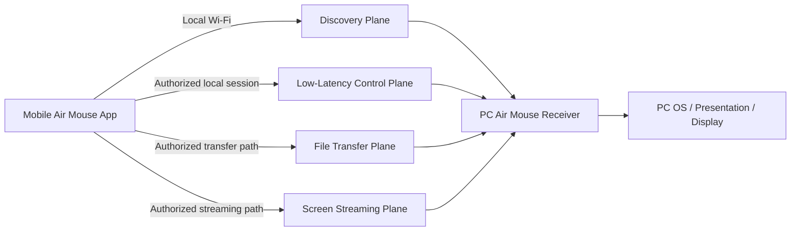
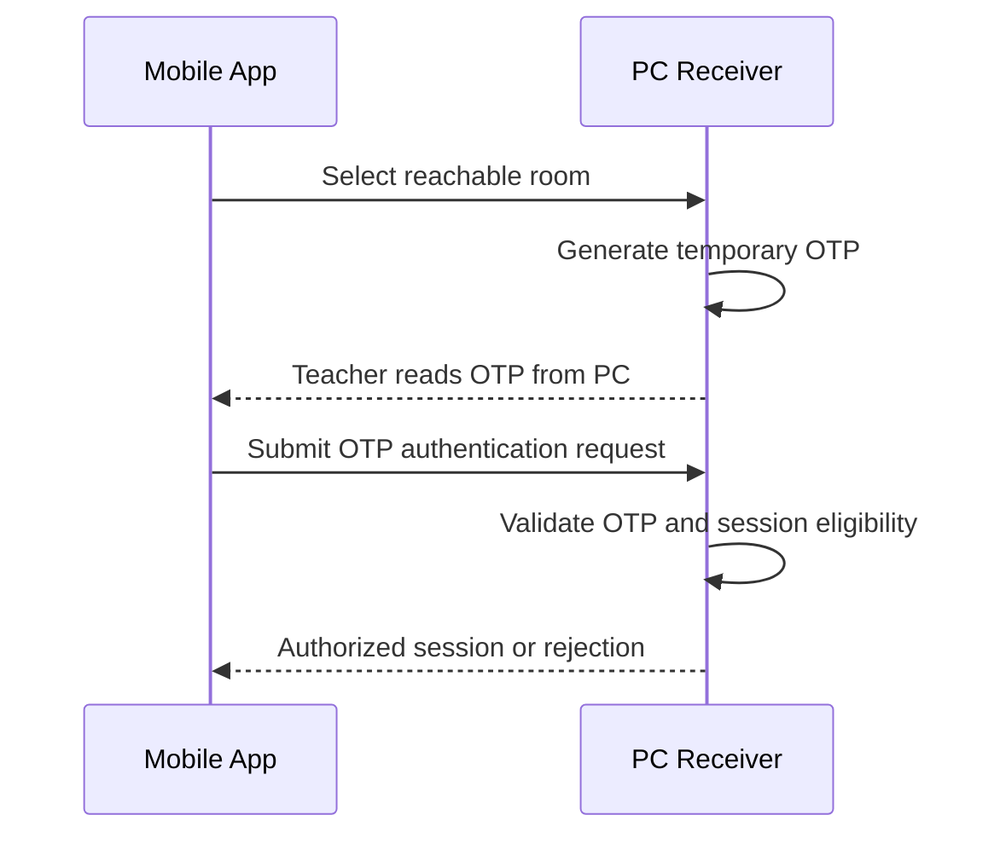

# Air Mouse for College Teaching — Network Requirements

## 1. Purpose and Scope

Air Mouse is a local mobile-phone-to-PC teaching control system over Wi-Fi:

```text
Mobile App → Local Wi-Fi → Air Mouse Receiver on Classroom PC
```

The phone communicates directly with the Air Mouse receiver running mainly in the PC background/system tray. Normal classroom operation requires no ESP32, Arduino, Bluetooth controller, intermediary hardware, or cloud server.

Teachers identify systems by room number. Internal device/network identifiers may exist for implementation purposes but are not normally shown to teachers. Networking must support discovery, authenticated control, file transfer, and real-time screen mirroring while keeping classroom interaction responsive and understandable.

Protocol, port, IP-range, framework, library, cloud-service, server, and implementation details are **TBD** unless explicitly defined elsewhere.

## 2. Network Architecture



The planes are logical separations. They need not be independent deployed services, but should not be forced through one mechanism when that harms performance or reliability.

| Plane | Purpose | Primary behavior |
|---|---|---|
| Discovery | Find reachable classroom PCs. | Local-network discovery; room-number UI; no authorization granted. |
| Pairing/authentication | Validate teacher connection with temporary OTP. | Establish authorized session. |
| Low-latency control | Gyro mouse, Trackpad, presentation, laser, and custom-command requests. | Small, timely messages; stale-input protection. |
| File transfer | Phone ↔ PC file delivery. | Reliable completion/progress/cancellation handling. |
| Real-time streaming | Full mobile screen mirroring to PC. | Time-sensitive continuous streaming and quality adaptation. |

## 3. Feature Traffic

| Feature | Network traffic category | Requirement |
|---|---|---|
| Mobile → PC discovery | Discovery | Local reachability and room identification only. |
| OTP pairing/authentication | Authentication/session | Temporary OTP validation before privileged use. |
| Gyro Mouse | Low-latency control | Frequent small relative movement updates; responsive and stale-safe. |
| Trackpad | Low-latency control | Relative movement, click, drag, and scroll events. |
| Presentation commands | Low-latency control | Discrete semantic commands; minimize duplicate/stale execution. |
| Laser Pointer | Low-latency control | Real-time pointer position/state updates. |
| Custom Commands | Low-latency control | Semantic allowlisted request/result, not arbitrary OS execution. |
| File Sharing | File transfer | Large/reliable data movement with progress and cancellation. |
| Screen Hosting | Streaming | Continuous encoded mobile-screen data with low latency. |

## 4. Discovery

When mobile opens or a teacher requests a refresh, it checks the current network environment and discovers reachable Air Mouse PCs on the local network. Discovery result UI contains only room number and availability/reachability status.

Examples:

- “Looking for classroom systems…”
- “Room 204 — Available”
- “Room 204 — Not available”
- “Room 204 — Connected”

Do not require teachers to understand IP addresses, hostnames, ports, MAC addresses, or similar details. Such information may exist only in an advanced diagnostic area if later needed.

The discovery mechanism is **TBD**. Selection must favor local operation, current network compatibility, low setup burden, multiple-PC support, safe stale-result handling, platform support, and suitability for college networks.

### Discovery behavior

| Situation | Required behavior |
|---|---|
| Multiple PCs | List reachable systems by room number and availability. |
| Duplicate room number | Do not silently choose one; warn and require safe disambiguation. Final disambiguation mechanism is **TBD**. |
| PC becomes unavailable | Update/remove availability state after suitable freshness checks; keep saved room visible as unavailable. |
| Network changes | Treat old discovery information as stale; rediscover on current network. |
| Discovery timeout | Show no systems found/refresh option; do not imply system is permanently gone. Timeout values are **TBD**. |
| Stale discovery result | Expire/refresh stale availability rather than showing falsely connected/reachable PC. |

## 5. Room Number and Identity

| Identity type | Purpose | Teacher visibility |
|---|---|---|
| Room number | User-facing identifier for classroom PC; selection and saved-room registration. | Primary visible identity. |
| Internal PC/device identity | Optional implementation identifier for distinguishing systems or resolving collisions. | Not a normal teacher-facing identifier. |
| Network address | Current technical reachability/routing information. May change. | Not shown in normal UI. |

First-time PC QR contains only the room number. It is room registration/identification, not authentication. QR must not contain IP address, passwords, OTPs, private keys, or sensitive network information unless explicitly required by a future approved design.

## 6. Authentication and Session Networking

After teacher selects a reachable room:

1. Mobile selects room.
2. PC generates and displays temporary OTP.
3. Teacher enters OTP on mobile.
4. Mobile submits authentication request.
5. PC validates OTP.
6. PC establishes authorized session if valid.
7. Control, transfer, and screen-hosting features become available only after authorization.



OTP is temporary and never a permanent password. Exact OTP length, expiry, retry limits, rate limiting, session timeout, session token mechanism, request format, and transport protection are **TBD**.

### Session lifecycle

- Wrong/expired OTP is rejected.
- Repeated attempts may receive protection/rate limiting; policy is **TBD**.
- Disconnect terminates authorization for that session.
- Session timeout, PC restart, mobile restart, or network loss must not leave stale authorization assumed valid.
- Reconnect behavior follows `PAIRING.md`; whether re-authentication is required is **TBD**.

## 7. Low-Latency Control Traffic

Gyro movement, Trackpad movement, clicks, scrolling, laser updates, presentation commands, and Custom Command requests require responsive communication.

Control traffic requirements:

- Use small control data rather than large payloads.
- Avoid unnecessary buffering and delays.
- Prioritize cursor/pointer responsiveness.
- Associate requests with authorized session.
- Avoid replaying stale movement after reconnect.
- Minimize duplicate discrete commands from retries, delayed delivery, or double taps.
- Prevent excessive pointer updates from overwhelming PC receiver; exact rate/backpressure strategy is **TBD**.

Specific message structure, delivery mechanism, command IDs, timestamps, acknowledgements, deduplication, and throttling are **TBD** and belong in `API_PROTOCOL.md`.

## 8. File Transfer Traffic

File transfer uses a dedicated transfer path separate from ordinary control messages. It supports Phone → PC and PC → Phone only in authorized sessions.

File transfer priorities are reliable delivery, visible progress, cancellation, destination/path safety, and clear incomplete-transfer handling. Large file contents must not delay mouse/presentation controls. File-transfer behavior is defined in `FILE_SHARING.md`.

Transfer transport, integrity checks, resume behavior, timeout policy, and traffic scheduling are **TBD**.

## 9. Real-Time Streaming Traffic

Screen Hosting is full real-time mobile screen mirroring:

```text
Mobile capture → encode → streaming-oriented Wi-Fi path → PC receive/decode → display
```

Streaming uses a dedicated streaming-oriented path because it is continuous, time-sensitive, and potentially bandwidth-intensive. It must not be treated as ordinary control traffic.

Priorities are low latency, continuous playable output, reasonable frame stability, and adaptation to network/device conditions. Exact codec, transport, bitrate adaptation, frame handling, and congestion policy are **TBD**. Requirements are defined further in `SCREEN_MIRRORING.md`.

## 10. Reliability and Reconnection

| Condition | Required behavior |
|---|---|
| Temporarily unstable Wi-Fi | Maintain service where practical; show degradation/reconnecting status when feature usability is affected. |
| Wi-Fi disconnected | Stop/suspend affected traffic safely; do not report stale success or keep sending controls. |
| Mobile switches networks | Treat prior discovery/session reachability as invalid; rediscover/reconnect on current network. |
| PC switches networks | End/revalidate reachability; mobile must not assume prior address/session works. |
| PC goes offline | Mark unavailable; stop active feature traffic safely. |
| Mobile goes offline | PC ends/marks session unavailable appropriately; stop active transfer/stream safely. |
| Receiver restart | Prior session is no longer assumed valid; PC returns to discoverable/waiting state. |
| Network address changes | Re-discovery identifies current reachability; teacher is not asked to manage address. |
| Reconnection | Recover only under valid session policy; stale commands, pointer deltas, file completions, or streams must not be replayed. |

The system must fail gracefully and never falsely show a PC as connected after it becomes unreachable or restarts.

## 11. Performance Requirements

| Workload | Priority |
|---|---|
| Gyro Mouse | Low latency, smooth responsive cursor movement. |
| Trackpad | Low latency and reliable click/drag/scroll responsiveness. |
| Presentation controls | Timely discrete command execution with duplicate prevention. |
| Laser Pointer | Smooth low-latency movement. |
| Custom Commands | Reliable semantic request/result, typically less frequent than pointer movement. |
| File transfers | Reliable progress/completion; may use available bandwidth without blocking controls. |
| Screen mirroring | Low-latency continuous stream with adaptable quality. |

No numerical latency, bandwidth, update-rate, or resource targets are defined yet; they are **TBD** and must be determined through prototype testing. The system should prioritize usable classroom responsiveness over unnecessary throughput or video quality.

## 12. Traffic Prioritization

The network design should prevent:

- Large file transfers from interfering with mouse movement.
- Screen mirroring from making presentation commands unresponsive.
- Excessive pointer updates from overwhelming the receiver.

Conceptual priorities are control responsiveness first, time-sensitive screen streaming next while preserving controls, and file transfer using remaining practical capacity. Exact scheduling, queuing, throttling, congestion control, and backpressure mechanisms are **TBD**.

A feature must reduce/degrade/fail clearly rather than silently making critical controls unusable.

## 13. Resource Efficiency

Networking should avoid unnecessary continuous traffic when no feature requires it.

Consider:

- Local Wi-Fi bandwidth consumption.
- Mobile battery use.
- PC CPU, network, and background receiver use.
- Session keep-alives where needed; exact policy **TBD**.
- Idle behavior after disconnect or feature stop.
- Background discovery frequency; exact interval **TBD**.
- Stream/file-transfer resource effects.

When no session is active, do not maintain feature-level traffic. When Gyro, Trackpad, Screen Hosting, and transfers are inactive, avoid corresponding continuous network work where practical.

## 14. Network Security

Same Wi-Fi membership alone does not make a device trusted.

Requirements:

- Discovery reveals availability/room identity only; it does not grant control.
- QR room registration does not authenticate device/user.
- OTP authentication establishes temporary authorized session.
- PC validates session authorization for all control, transfer, stream, and Custom Command requests.
- Unauthorized/invalid/stale requests are rejected.
- File transfers and screen streams require authorized session by default.
- Custom Commands use PC-side allowlisting and cannot become arbitrary remote execution.
- Discovery information exposes minimal teacher-facing data.
- Screen stream is not unnecessarily exposed to other local devices.

Specific cryptographic algorithms, encryption, secure transport, token design, and discovery privacy mechanism are **TBD**. They must protect classroom use without requiring unjustified cloud infrastructure.

## 15. Network Isolation and Classroom Environments

College networks may block direct local communication even if phone and PC appear connected to Wi-Fi. Relevant conditions include guest Wi-Fi, AP/client isolation, VLAN segmentation, different Wi-Fi networks, firewall restrictions, blocked peer-to-peer traffic, and corporate/college policies.

| Environment problem | Required application behavior |
|---|---|
| Guest Wi-Fi / AP isolation | Explain that devices cannot reach each other on this network; advise using permitted same-classroom network or contacting IT. |
| Different Wi-Fi networks | Explain that phone and PC must be reachable on same permitted local network. |
| VLAN/network segmentation | Show room unavailable/not discoverable; do not expose technical diagnostics by default. |
| Firewall/peer traffic block | Explain local classroom PC cannot be reached; offer retry and optional diagnostic/settings guidance. |
| College policy restriction | Explain local connectivity is unavailable and that network policy/IT configuration may be needed. |

Do not introduce a cloud fallback unless explicitly added in a later product decision.

## 16. Teacher-Facing Status and Errors

Use plain messages rather than networking jargon:

| Condition | Example message intent |
|---|---|
| Discovering | “Looking for classroom systems…” |
| No systems found | “No classroom PCs found. Check that both devices are on the same Wi-Fi.” |
| Room unavailable | “Room 204 is not available. Try again.” |
| Network changed | “Network changed. Looking for classroom systems again.” |
| Connection lost | “Connection lost. Reconnecting…” |
| PC unavailable | “PC is unavailable. Check that Air Mouse is running.” |
| Network policy/isolation | “This network does not allow connection to the classroom PC. Contact classroom IT if needed.” |

Do not show IP addresses, ports, MAC addresses, internal service IDs, protocol errors, or stack traces in normal teacher UI.

## 17. Testing Requirements

| Area | Required test cases |
|---|---|
| Normal operation | Phone and PC on same Wi-Fi; discovery, authentication, and feature traffic. |
| Multiple systems | Multiple PCs visible and selectable. |
| Identity conflict | Duplicate room numbers handled without silent selection. |
| Availability | PC unavailable and mobile unavailable. |
| Network mismatch | Wrong Wi-Fi, mobile/PC network switch, address change. |
| Disconnection | Wi-Fi disconnect and reconnection. |
| Restricted networks | Guest network, AP isolation, VLAN separation, firewall/peer blocking where testable. |
| Traffic coexistence | Simultaneous file transfer + mouse control. |
| Streaming coexistence | Simultaneous screen mirroring + control/presentation actions. |
| Endurance | Long classroom session with discovery/session/control behavior. |

Testing must verify user-facing status correctness, stale-session prevention, control responsiveness, and safe recovery—not only raw network reachability.

## 18. Technology Decisions

Do not invent protocols, ports, IP ranges, frameworks, libraries, cloud services, network servers, or implementation code.

| Decision | Status | Selection criteria |
|---|---|---|
| Discovery technology | TBD | Local reachability, network compatibility, multiple-PC behavior, low setup burden, privacy. |
| Authentication/session transport | TBD | OTP/session security, local reliability, platform support, manageable complexity. |
| Low-latency control transport | TBD | Responsiveness, small-message efficiency, duplicate/stale handling, resource use. |
| File-transfer transport | TBD | Reliable delivery, progress/cancellation, safe interruption behavior, bandwidth coexistence. |
| Screen-stream transport/codec | TBD | Low latency, device support, hardware acceleration, adaptive quality, resource use. |
| Traffic prioritization method | TBD | Preserve controls under transfer/stream load without over-engineering. |
| Security/transport protection | TBD | Local-network threat model, authorization protection, practical prototype complexity. |

## 19. Documentation Boundaries

- `ARCHITECTURE.md` describes overall components and communication planes.
- `PAIRING.md` defines room registration, discovery behavior, OTP, and session lifecycle in detail.
- `SECURITY.md`, if present, defines broader security requirements.
- `API_PROTOCOL.md`, if present, defines concrete messages/protocols.
- `FILE_SHARING.md` defines transfer behavior and file/path safety.
- `SCREEN_MIRRORING.md` defines streaming behavior and performance/recovery.

## 20. Acceptance Criteria

- [ ] Local phone-to-PC Wi-Fi architecture is defined without ESP32, Arduino, Bluetooth, intermediary hardware, or required cloud service.
- [ ] Discovery presents room number and reachability without requiring technical network knowledge.
- [ ] Room number, internal identity, and network address are clearly distinguished.
- [ ] QR contains room number only and is not authentication.
- [ ] OTP/session networking gates privileged features.
- [ ] Low-latency control, file transfer, and screen-stream traffic are clearly separated.
- [ ] Control traffic prioritizes mouse, Trackpad, presentation, laser, and command responsiveness.
- [ ] File transfers prioritize reliable delivery and do not use ordinary control messages for file data.
- [ ] Screen streaming prioritizes continuous low-latency output and does not use ordinary control messages for frames.
- [ ] Network loss, PC/mobile restart, address change, reconnection, and stale session conditions are handled safely.
- [ ] Same Wi-Fi alone is not treated as authorization.
- [ ] Classroom network restrictions and teacher-facing guidance are defined.
- [ ] Resource efficiency and traffic coexistence are considered.
- [ ] Practical discovery, restricted-network, interruption, endurance, file/control, and stream/control tests are defined.
- [ ] Undecided networking choices are marked **TBD** with selection criteria.
