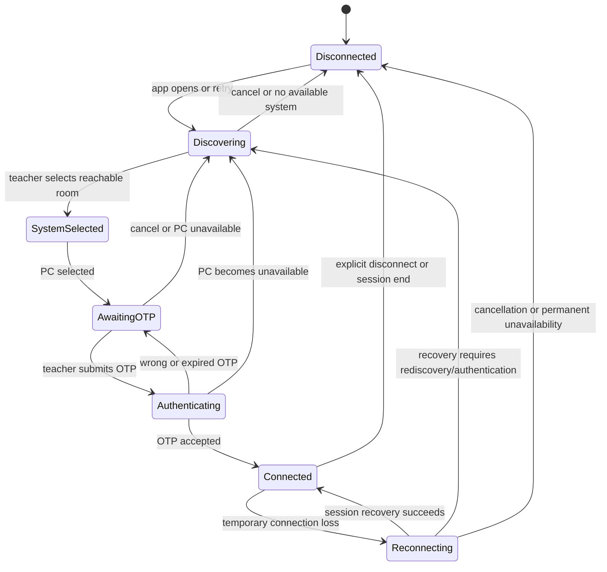
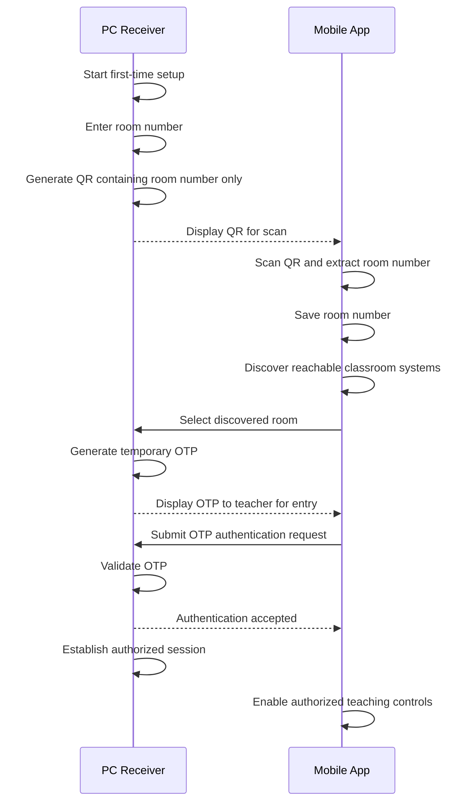

# Air Mouse for College Teaching — Pairing, Discovery, and Connection Lifecycle

## 1. Purpose

Air Mouse connects a teacher’s mobile phone to a classroom PC using **Mobile Phone → Wi-Fi → PC Receiver**. The phone is the teacher’s controller; the PC receiver is the classroom system being controlled.

This pairing system must be simple enough for routine classroom use while preventing unauthorized control of the PC. The architecture has no ESP32, Arduino, Bluetooth controller, or intermediary hardware.

This document defines pairing, discovery, authentication, session establishment, disconnection, and connection lifecycle only. It does not define implementation code or a specific technical transport/security mechanism.

## 2. Identity Rules

| Concept | Requirement |
|---|---|
| Room Number | Teacher-facing identifier of a classroom PC. It is used to identify and select a system and is stored by the mobile application after registration. |
| Internal System Identity | An implementation may require an internal identifier to distinguish systems. It must not replace room number in normal teacher-facing UI. Exact implementation is **TBD**. |
| Authentication | A room number alone must never authorize control. QR registration is not authentication. OTP authentication is required before an authorized control session begins. |

The normal interface uses room numbers, not internal IDs, IP addresses, MAC addresses, ports, or comparable technical information.

## 3. First-Time PC Setup

1. The PC Air Mouse receiver starts for the first time.
2. The PC asks the administrator or teacher for the classroom room number.
3. The administrator or teacher enters the room number.
4. The PC generates a QR code.
5. The QR code contains **only the room number**.
6. The PC displays the QR code.
7. The teacher opens the mobile Air Mouse app.
8. The teacher scans the QR code.
9. The mobile app extracts and stores the room number.
10. The PC enters a waiting state for future discovery and authentication.

The QR is solely for room identification/registration. It does not authenticate the mobile device. It must not contain passwords, OTPs, network credentials, private keys, or other authentication secrets.

## 4. QR Code Requirements

### Required behavior

- QR payload contains only the room number.
- QR display is sufficiently clear and large to scan conveniently.
- Successful scanning gives immediate confirmation that the room has been saved.
- Invalid, unsupported, or incorrectly structured QR data produces a clear error and must not crash the app.
- Re-scanning an existing room is handled gracefully.

| Situation | Expected behavior |
|---|---|
| Empty room number | Do not generate QR; explain that a room number is required. |
| Invalid room number | Do not generate QR; identify invalid input and request correction. Validation details are **TBD**. |
| QR generation failure | Show generation failed, preserve entered room number where possible, and offer retry. |
| QR scanning failure | Show scan failed and offer retry/cancel. |
| Wrong QR scanned | Explain it is not a valid Air Mouse room-registration QR; do not save it. |
| Room already saved | Inform teacher that the room already exists; allow keeping the existing entry or re-registering it. Exact choice UX is **TBD**. |

## 5. Mobile Saved Rooms

After successful QR scanning, the mobile app stores the room number locally. The saved room is available for later selection, so the teacher does not need to scan the QR for every connection.

Saved-room UI shows room number and current availability/connection state. The teacher can remove a saved room through room/system management. Removing a saved room removes only the phone’s registration; it does not reconfigure the PC or disconnect other sessions unless a separate active-session action is chosen.

Re-registering a room updates or confirms the saved registration according to implementation policy, which is **TBD**. A saved room that is not currently reachable remains visible as unavailable and does not require manual entry of technical network information.

## 6. PC Discovery

When the mobile app opens, it checks the current Wi-Fi/network environment and discovers reachable Air Mouse PCs. It matches discovered systems with saved room information where applicable and displays available systems using room number. The teacher selects the desired room.

Discovery is local-network focused. A mandatory cloud server must not be introduced unless the architecture explicitly changes later. The technical discovery mechanism is **TBD**.

## 7. Discovery UI

Teacher-facing discovery states use plain language and room numbers:

| State | Example display |
|---|---|
| Discovering | “Looking for classroom systems…” |
| Available | “Room 204 — Available” |
| Unavailable | “Room 204 — Not available” |
| Connected | “Room 204 — Connected” |

Do not display IP addresses, MAC addresses, internal service IDs, network ports, or other technical information in normal discovery UI. Such information may exist only in an advanced diagnostics/settings area if later required.

## 8. Multiple Classroom PCs

The system supports multiple Air Mouse PCs on the same Wi-Fi network, such as Room 101, Room 102, Room 204, and Room 305. The teacher selects the required room from the discovered/saved-room view.

| Situation | Required behavior |
|---|---|
| Multiple systems discovered | Show each reachable system by room number and availability. |
| Saved room not reachable | Retain it in saved rooms and label it unavailable; allow retry. |
| Discovered room not saved | Show it as a reachable room where appropriate and allow registration/selection according to UX policy, **TBD**. |
| Duplicate room number | Never silently choose one. Warn that duplicate room numbers exist and require a safe disambiguation process. The final disambiguation design is **TBD**. |

## 9. OTP Authentication

After the teacher selects a reachable PC:

1. The selected PC generates a temporary OTP.
2. The PC displays the OTP.
3. The teacher enters the OTP in the mobile app.
4. The mobile sends an authentication request.
5. The PC validates the OTP.
6. If valid, the PC creates an authorized session.
7. If invalid, the PC rejects the connection.

An OTP is temporary, expiring, and single-use or otherwise protected against reuse according to the final implementation. It is never stored permanently as a password. OTP length, generation method, expiry duration, reuse protection, and retry policy are **TBD**.

## 10. OTP UI States

### Waiting

**PC:** Shows room number, temporary OTP, expiry information, and waiting-for-mobile state.

**Mobile:** Shows selected room, OTP input, and a back/cancel action.

### Authenticating

Both sides show a short verification/loading state. The mobile must not imply that control is available until verification succeeds.

### Success

Both sides show Connected, room number, and Ready status. The mobile enables authorized teaching features.

### Failure

Use clear, actionable outcomes: Wrong OTP, Expired OTP, PC unavailable, or Authentication failed. The message tells the teacher whether to retry, obtain a new code, select another system, or check PC/network availability.

## 11. OTP Failure Handling

| Condition | Required behavior |
|---|---|
| Wrong OTP | Reject authentication, inform teacher, and allow retry under configured retry policy. |
| Expired OTP | Reject authentication and require a newly generated/current OTP. |
| Too many failed attempts | Apply temporary protection/rate limiting if appropriate. Exact mechanism and policy are **TBD**. |
| PC disconnects during OTP entry | Cancel authentication, clearly state the PC is unavailable, and return mobile to an appropriate discovery/selection state. |

No failed or expired OTP may authorize control.

## 12. Session Establishment

After successful OTP verification, create an authorized session. The session permits the mobile app to use authorized Air Mouse features:

- Gyro Mouse
- Trackpad
- Laser Pointer
- Presentation Controls
- File Sharing
- Screen Hosting
- Custom Commands

Authentication authorizes the session rather than requiring a new OTP for every cursor movement or presentation action. The exact session-token/session-state mechanism is **TBD**.

## 13. Authorization Boundaries

### Before authentication

A mobile device may:

- Discover reachable systems.
- Identify/select a room.
- Perform the required OTP authentication flow.

It must not:

- Move the PC cursor.
- Send keyboard or presentation commands.
- Start Screen Hosting.
- Transfer files.
- Execute Custom Commands.

### After authentication

Only authorized operations are permitted. The PC validates requests before performing sensitive operations. Authorization ends when the session is terminated, invalidated, or no longer valid under the eventual session policy.

## 14. Connection Lifecycle

Required states are Disconnected, Discovering, System Selected, Awaiting OTP, Authenticating, Connected, and Reconnecting.

Valid transitions must be visible to the teacher through clear status text and appropriate enabled/disabled controls. The UI must distinguish a temporary reconnecting state from a permanent unavailable state and from authentication failure.

## 15. Disconnect

The teacher can explicitly disconnect from the mobile app or PC receiver. On disconnect:

1. The session is terminated.
2. The PC stops accepting control requests from that session.
3. The mobile returns to Disconnected state.
4. The room remains saved for future discovery and connection.

Disconnecting must not remove saved-room registration.

## 16. Unexpected Connection Loss

Unexpected loss can result from Wi-Fi disconnection, mobile movement to another network, PC network change, PC receiver closing, PC shutdown, mobile-app suspension, or temporary signal loss.

The interface distinguishes:

- **Temporary connection loss:** session may be recoverable; show Reconnecting.
- **Permanent unavailability:** PC cannot currently be reached; show unavailable and offer discovery/retry.
- **Authentication failure:** request was rejected; do not label it as a network failure.

Automatic reconnection may be supported, but its exact eligibility, timeout, whether re-authentication is required, and recovery behavior are **TBD**. Until a session is restored, control actions must be unavailable or safely ignored.

## 17. Network Changes

When the teacher leaves classroom Wi-Fi, switches Wi-Fi, uses mobile data, or returns to classroom Wi-Fi, the mobile app must not assume that the old PC connection remains valid. It detects the change where possible, ends or suspends stale session state safely, and rediscovers available Air Mouse systems when appropriate.

Mobile data does not imply reachability to a classroom PC. On return to classroom Wi-Fi, the app should rediscover systems and then reconnect/authenticate according to the final reconnection policy, **TBD**.

## 18. Active Session Policy

The architecture must safely handle multiple mobile devices attempting to connect to the same PC and avoid unauthorized simultaneous control. Competing authentication attempts must not result in silent unauthorized access or ambiguous control ownership.

The final concurrency policy—such as one active teacher session per PC, permitted additional sessions, session handoff, or conflict resolution—is **TBD**. If one active teacher session is adopted, the PC must clearly report that the system is already in use and provide a safe authorized resolution path.

## 19. Security Requirements

- Room number is not authentication.
- QR is not authentication.
- OTP is temporary.
- Authentication occurs before control.
- Expired OTPs cannot authorize access.
- Unauthorized control requests are rejected.
- File sharing requires an authenticated session by default.
- Custom Commands require authorization.
- Arbitrary remote shell execution is not permitted by default.
- Session termination invalidates authorization appropriately.
- Specific cryptographic algorithms, transport protection, and token mechanics are **TBD** and are not prescribed here.

## 20. Data Storage

| Side | May store |
|---|---|
| Mobile | Saved room number, connection preferences, local settings, and session information as required. |
| PC | Configured room number, PC configuration, authorized-session state, and application settings. |

OTP must not be stored as a permanent credential. This document does not require a database or prescribe a persistence technology.

## 21. Privacy

Pairing minimizes exposed information. Teacher-facing identification primarily uses room number and connection state. Do not expose IP address, MAC address, device hostname, or internal IDs unless they are needed in a diagnostics/settings area.

## 22. Error Messages

| Condition | Message intent and next action |
|---|---|
| No systems found | State that no classroom systems were found on current Wi-Fi; offer retry. |
| Room not found | State that the selected/saved room was not found; offer discovery or room selection. |
| Room unavailable | State that the room is unavailable; offer retry. |
| QR invalid | State that the QR is not a valid Air Mouse room QR; offer scan again. |
| QR scan failed | State scanning failed; offer retry/cancel. |
| Duplicate room number | State that more than one system uses the room number; require safe selection/disambiguation. |
| OTP required | Ask teacher to enter temporary code shown on selected PC. |
| OTP incorrect | State that code was not accepted; allow retry as policy permits. |
| OTP expired | State that code expired; request current/new PC code. |
| Authentication failed | State that connection could not be authorized; offer retry or return to selection. |
| Connection lost | State that control has stopped because connection was lost; show reconnecting/retry action. |
| Reconnecting | State that the app is attempting to restore connection; do not show control as active. |
| Session ended | State that connection ended; allow reconnect/select room. |
| Network changed | State that network changed and rediscovery/reconnection is required or underway. |

## 23. Pairing Sequence Diagram

The diagram is conceptual and technology-independent.

## 24. Pairing Flow Summary

### First-time registration

1. PC receiver starts.
2. Administrator/teacher enters room number.
3. PC generates/displays QR containing only that room number.
4. Mobile app scans QR.
5. Mobile app saves room number.

### Normal connection

1. Mobile app discovers reachable systems on current Wi-Fi.
2. Teacher selects room.
3. PC displays temporary OTP.
4. Teacher enters OTP on mobile.
5. PC validates OTP.
6. Authorized session starts if validation succeeds.

### Disconnect

1. Teacher disconnects on mobile or PC.
2. Session terminates and authorization is invalidated appropriately.
3. Mobile shows Disconnected.
4. Saved room remains available.

### Reconnection

1. Connection loss is detected.
2. UI shows Reconnecting or unavailable.
3. The system attempts reconnection/discovery/authentication according to policy.
4. Exact automatic-reconnection and re-authentication behavior is **TBD**.

## 25. Acceptance Criteria

Pairing and connection lifecycle are complete when:

- [ ] A PC can be configured with a room number.
- [ ] A PC can generate a QR containing only the room number.
- [ ] Mobile can scan and save the room number.
- [ ] Mobile can discover reachable Air Mouse PCs.
- [ ] Multiple rooms can be displayed.
- [ ] A teacher can select a room.
- [ ] A PC can display a temporary OTP.
- [ ] Mobile can submit the OTP.
- [ ] A valid OTP establishes an authorized session.
- [ ] Invalid or expired OTP cannot authorize control.
- [ ] Unauthenticated devices cannot control the PC.
- [ ] A teacher can disconnect.
- [ ] Saved room information remains after disconnect.
- [ ] Connection loss is clearly communicated.
- [ ] Network changes are handled safely.
- [ ] Technical network identifiers are not unnecessarily exposed.
- [ ] Pairing requires no ESP32, Arduino, Bluetooth, or intermediary hardware.
