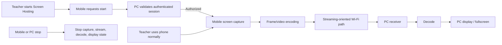

# Air Mouse for College Teaching — Screen Mirroring Requirements

## 1. Purpose

Screen Hosting provides true live, full-screen mirroring of the teacher’s mobile phone to the classroom PC over Wi-Fi. It is not file sharing and does not mean sending selected images or videos.

Conceptual flow:

```text
Mobile screen capture → video/frame encoding → Wi-Fi network → PC receiver/decoder → PC display
```

The teacher must continue using the phone normally while its display is mirrored. The feature is intended for responsive classroom teaching and prioritizes low perceived latency and reliable usability over unnecessarily high video quality.

## 2. Scope and Constraints

Screen Hosting supports:

- Start and stop from the mobile main screen.
- Full mobile-screen mirroring.
- Portrait and landscape display.
- Automatic rotation handling.
- Fullscreen display on PC.
- PC-side streaming status.
- Low-latency transmission.
- Configurable quality and FPS where practical.
- Configurable resolution/bitrate where practical.
- Hardware-accelerated encoding/decoding where available.
- Graceful fallback where hardware acceleration is unavailable.

The feature uses direct mobile-phone-to-PC local Wi-Fi communication within an authenticated Air Mouse session. It does not add screen recording, persistent recordings, or stored mirrored frames. Codecs, protocols, ports, libraries, frameworks, APIs, hardware specifics, and deployment details are **TBD**.

## 3. Architecture



The architecture is logical rather than a prescription for separate services. It must remain practical for a college-project prototype.

## 4. Streaming Communication Path

Screen mirroring uses a streaming-oriented communication path separate from normal low-latency mouse, laser, and presentation-control messages.

| Communication type | Characteristics |
|---|---|
| Control commands | Small, discrete or frequent low-payload inputs; prioritize immediate response and stale-input prevention. |
| File transfer | Potentially large, completion-oriented data; supports progress, cancellation, and interruption handling. |
| Screen stream | Continuous time-sensitive encoded frame/video data; requires ordering/timeliness, frame-rate management, and quality adaptation. |

Large video/frame data must not be sent as ordinary control messages because it can delay cursor/presentation actions and has different buffering, loss, quality, and recovery needs. File transfer also must not be treated as ordinary control traffic.

The stream transport, codec, capture mechanism, encoder/decoder implementation, quality adaptation, and authentication binding are **TBD**. Selection criteria include local Wi-Fi suitability, latency, platform capability, hardware acceleration availability, resource use, implementation complexity, security, and testability.

## 5. Start and Stop Lifecycle

### Start Screen Hosting

1. Teacher taps **Screen Hosting** from the mobile main screen.
2. Mobile shows the selected connected room and start state.
3. Mobile requests screen-hosting start through the authorized session.
4. PC validates that the session is authorized for Screen Hosting.
5. If accepted, mobile begins screen capture.
6. Mobile encodes captured frames.
7. Encoded stream travels over Wi-Fi to PC.
8. PC receives, decodes, and displays the mobile screen.
9. Mobile and PC show an active-hosting state.

Screen capture permission/approval behavior is platform-dependent and **TBD**, but the teacher must receive a clear explanation if permission is unavailable or denied.

### Stop Screen Hosting

Either mobile or PC may stop the stream. Stopping must:

- End or release mobile capture activity safely.
- Stop stream transmission and PC decoding/display updates.
- Clear the PC’s active-hosting state.
- Return mobile and PC to normal connected state.
- Show concise stopped feedback.

The PC must not remain falsely shown as hosting after a stream/session has ended.

## 6. Mobile Experience

Screen Hosting is available directly from the mobile main screen. Starting should require minimal interaction and must not force the teacher into advanced settings.

| State | Mobile requirements |
|---|---|
| Ready | Screen Hosting action available when authenticated and supported. |
| Starting | Show concise preparing/connecting state; keep cancel available where practical. |
| Active | Persistent, unmistakable active-hosting indicator and easy Stop action. |
| Reconnecting | Show that stream is interrupted/recovering; do not imply display is live. |
| Error | Explain failure in teacher-friendly language and offer Retry or Stop/return. |
| Stopped | Confirm mirroring is stopped and return to standard connected UI. |

The active indicator must make it obvious that the phone screen is being mirrored. The teacher remains able to operate the phone normally while hosting.

## 7. PC Experience

The PC receiver primarily runs in the system tray/background. Mirroring display must not unnecessarily cover the desktop with the Air Mouse control UI.

The PC provides:

- A dedicated display window or display surface for the mirrored phone screen.
- Current hosting status in system-tray/compact receiver UI.
- Connected room/device status where appropriate.
- Fullscreen action where supported.
- Stop action where appropriate.
- Compact notifications for start, stop, failure, and recovery.

Exact window behavior, display-surface implementation, and PC controls are **TBD**. The receiver should remain unobtrusive during teaching.

## 8. Orientation and Display

### Orientation

- Support portrait mobile display.
- Support landscape mobile display.
- Detect and handle phone rotation while hosting.
- Update PC output to reflect changed orientation without presenting an incorrectly rotated or stale view.

### Aspect ratio and scaling

Preserve the mobile screen aspect ratio. Use scaling and letterboxing/pillarboxing where necessary rather than distorting content. Exact scaling policy is **TBD**.

### Fullscreen and displays

PC provides fullscreen display where supported. Multiple-PC-display behavior is platform-dependent and **TBD**. Where supported, PC may allow selection of display target; where unavailable, it must use a clear default and avoid implying capabilities that do not exist.

## 9. Quality Configuration

Screen Hosting exposes practical settings in advanced Screen Hosting settings, not as a burden on the main teaching screen.

| Setting | Requirement |
|---|---|
| Video quality | User-configurable quality level where practical. |
| FPS | User-configurable target frame rate where practical. |
| Resolution | User-configurable resolution level where practical. |
| Bitrate | User-configurable/managed bitrate where practical. |
| Hardware acceleration | Use available hardware acceleration for encode/decode when available. |

Exact presets, numerical ranges, defaults, and whether all settings are exposed are **TBD**. When hardware acceleration is unavailable, provide a graceful fallback if feasible; otherwise explain feature limitations clearly. Fallback should favor usable classroom responsiveness over maximum visual quality.

## 10. Performance Requirements

Screen Hosting must balance:

- Low end-to-end latency.
- Smooth playback.
- Frame-rate stability.
- Available Wi-Fi bandwidth.
- Mobile CPU/GPU use and battery consumption.
- PC CPU/GPU and display resource use.
- Resolution, FPS, bitrate, and quality trade-offs.

The system prioritizes responsiveness suitable for explaining content during class rather than unnecessarily high video fidelity. Avoid unnecessary buffering, large latency-inducing queues, or resource-heavy processing that makes normal phone/PC use impractical.

Exact latency, FPS, resource, and bandwidth targets are **TBD** and must be established through prototype testing across supported devices/network conditions.

## 11. Adaptive Quality

When network or device conditions degrade, the system should adapt quality/bitrate/FPS where practical to preserve a usable responsive stream. Possible adaptation dimensions are resolution, bitrate, frame rate, and visual quality. Exact policy is **TBD**.

Adaptation must provide clear status when degradation materially affects hosting. It should avoid making the stream appear active and healthy when it has stalled or become unusable.

## 12. Network and Stream Recovery

| Condition | Expected behavior |
|---|---|
| Temporary Wi-Fi degradation | Attempt quality adaptation where supported; show degraded/recovering state if needed. |
| Network disconnection | Stop active frame delivery safely; mobile/PC show interruption; do not show falsely live stream. |
| Mobile changes network | Treat old stream path/session reachability as invalid; stop or recover only under valid reconnection policy. |
| PC receiver unavailable | End/pause stream safely; notify mobile that PC is unavailable. |
| Decoder failure | Stop/interrupt display safely; notify user and offer retry/stop. |
| Encoder failure | Stop/interrupt capture/stream safely; notify user and offer retry/stop. |
| Screen-capture failure | Explain capture could not continue; stop active state safely. |
| Stream timeout | Treat as interrupted/unavailable; clear falsely active PC state and offer recovery. |
| Reconnection | Restore stream only after valid session/reachability recovery; exact automatic-restart policy is **TBD**. |
| Explicit stop | End capture, stream, decode, display state, and active indicators. |

Reconnection behavior must not accidentally resume an unauthorized, stale, or previously ended stream. Pairing/session requirements follow `PAIRING.md`.

## 13. Security and Privacy

- Only an authenticated and authorized Air Mouse session may start Screen Hosting.
- PC validates session authorization before accepting start, stream, or control requests.
- Unauthenticated devices must not receive the screen stream.
- The screen stream must not be unnecessarily exposed to other devices on the local network.
- Mobile clearly indicates that Screen Hosting is active.
- Mobile provides an obvious stop action at all times while active.
- Screen recording is not included.
- Mirrored frames or recordings are not stored unless explicitly added as a future feature.

Specific encryption, transport security, access-control, stream-key, or cryptographic implementation is **TBD**. Any choice must preserve local-network simplicity while protecting authorized classroom use.

## 14. Error Handling

Errors use teacher-friendly messages with recovery actions and never expose technical stack traces.

| Error | User-facing behavior |
|---|---|
| Screen-capture permission unavailable | Explain permission is required/unavailable; offer settings/retry/cancel as platform capabilities permit. |
| Screen capture unsupported | Explain that this device cannot host its screen with current capability. |
| Encoder unavailable | Explain that Screen Hosting cannot start on the phone; offer retry/return. |
| Network unavailable | Explain that classroom PC connection is unavailable; offer reconnect/retry. |
| PC unavailable | Explain receiver is not reachable/running; offer retry or return. |
| Decoder failure | Explain PC could not display stream; stop/retry safely. |
| Insufficient bandwidth | Explain stream quality is reduced or cannot continue; offer retry/stop and use adaptation where available. |
| Stream disconnected | Explain mirroring stopped/interrupted; show reconnecting or restart option. |
| Unsupported display configuration | Explain PC display arrangement/capability is unsupported; offer a supported display/default if available. |

Errors must not leave capture, display, notification, or active-status UI in contradictory states.

## 15. Reliability Requirements

- Starting requires authorized session and explicit user action.
- A stopped/failed session clears active state on both devices.
- PC does not remain falsely active after timeout, receiver restart, or session termination.
- Mobile does not continue claiming successful hosting when PC is unavailable.
- Rotation does not create persistent stale orientation.
- Stream recovery does not replay obsolete content or bypass session authorization.
- Main control commands remain logically separated from stream payloads.

## 16. Testing Requirements

| Area | Required test cases |
|---|---|
| Start/stop | Start mirroring, stop from mobile, stop from PC, repeated start/stop. |
| Orientation | Portrait → landscape; landscape → portrait; rotation during active stream. |
| Network | Low-bandwidth Wi-Fi, temporary disconnection, reconnection, mobile network change. |
| Duration/resources | Long classroom session, high mobile CPU usage, high PC CPU usage, battery/resource observation. |
| Display | Fullscreen mode, multiple displays where supported, unsupported display configuration. |
| Restart | Mobile app restart and PC receiver restart during/after hosting. |
| Security | Unauthorized device attempting to start hosting; session expiry/termination while hosting. |
| Failure | Capture permission unavailable, capture unsupported, encoder failure, decoder failure, timeout, PC unavailable. |

Testing must assess low-latency usability, smoothness, state correctness, error clarity, and recovery—not merely whether a frame appears on the PC.

## 17. Relationship to Other Documents

- `ARCHITECTURE.md` defines the overall mobile/PC communication architecture and communication-plane separation.
- `FEATURES.md` defines feature-level Screen Hosting behavior and dependencies.
- `UI_UX.md` defines detailed visual/UI requirements for mobile and PC states.
- `PAIRING.md` defines discovery, OTP authentication, authorization, and session lifecycle.
- `PRD.md` contains product requirements if present.

This document does not define pairing mechanics, mouse behavior, file sharing, or concrete network/protocol implementation.

## 18. Acceptance Criteria

- [ ] Mobile can request Screen Hosting from the main screen.
- [ ] Only an authenticated/authorized session can start mirroring.
- [ ] Full mobile-screen capture is performed for live mirroring.
- [ ] Captured frames are encoded, transmitted over Wi-Fi, received, decoded, and displayed on PC.
- [ ] Teacher can continue using phone normally while mirroring.
- [ ] Mobile and PC expose clear starting, active, stopped, reconnecting, and error states.
- [ ] Mobile or PC can stop the stream.
- [ ] Portrait and landscape modes work.
- [ ] Rotation is handled without persistent incorrect orientation.
- [ ] PC fullscreen display works where supported.
- [ ] Quality/FPS and resolution/bitrate are configurable where practical.
- [ ] Hardware acceleration is used where available, with graceful fallback or clear limitation where unavailable.
- [ ] Screen stream uses a streaming-oriented path separate from control messages.
- [ ] Low-latency responsiveness is prioritized over unnecessary visual quality.
- [ ] Network degradation, disconnect, timeout, encoder/decoder/capture failure, and PC unavailability are clearly handled.
- [ ] Recovery never bypasses session authorization or leaves falsely active state.
- [ ] No screen recording or persistent mirrored-frame storage exists.
- [ ] Performance, orientation, network, restart, display, and unauthorized-start scenarios are tested.
