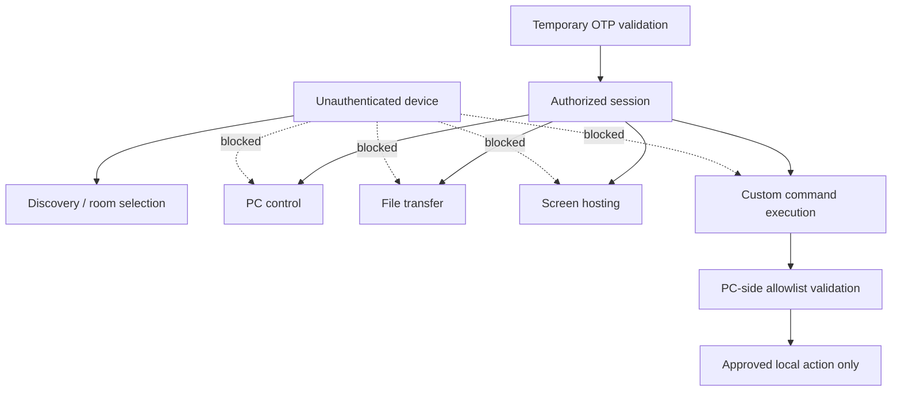

# Air Mouse for College Teaching — Security Requirements

## 1. Security Goals

Air Mouse is a local mobile-phone-to-PC teaching control system over Wi-Fi. Because a mobile app can control a classroom PC and access file/screen-hosting features, the system must prevent unauthorized control and unnecessary exposure of data.

Security objectives:

- Only an authorized teacher/device can control a PC.
- Discovery does not automatically grant access.
- Room-number QR codes do not authenticate devices.
- Temporary OTP authentication establishes an authorized session.
- File transfers require authorization.
- Screen mirroring requires authorization.
- Custom commands are validated by the PC.
- Arbitrary shell/terminal execution is not exposed.
- Sensitive information is not unnecessarily stored or transmitted.
- Sessions are invalidated when appropriate.

This document defines security requirements for a practical college-project prototype. It does not prescribe cryptographic algorithms, libraries, frameworks, ports, protocols, or implementation code. Such decisions are **TBD**.

## 2. Security Scope and Trust Boundaries

The PC is the enforcement point for privileged local actions. The mobile client is not trusted to determine whether it may control the PC, access files, stream screen content, or execute commands. Being on the same Wi-Fi does not make a device trusted.

## 3. Threat Model

### Realistic classroom/local-network threats

| Threat | Required protection |
|---|---|
| Unauthorized device on same Wi-Fi | Discovery alone does not authorize; OTP and session validation are required. |
| Someone scans room QR | QR only provides room number; it grants no session or PC control. |
| OTP guessing | OTP is temporary; failed attempts are rejected; retry/rate-limit policy is **TBD**. |
| Replay of old authentication request | Expired/used/invalid OTP must not create session; replay protection details are **TBD**. |
| Replay/duplication of control commands | PC validates session/request freshness and avoids unintended duplicate actions where practical. |
| Malicious Custom Command request | PC allowlist, command-ID validation, parameter validation, no arbitrary shell execution. |
| Malicious file-transfer request | Session validation, filename/path validation, destination restrictions, permission/storage checks. |
| Path traversal/filesystem abuse | PC rejects path escape/traversal and does not expose unrestricted filesystem access. |
| Screen-stream interception | Stream access is restricted to authorized session; transport protection details are **TBD**. |
| Man-in-the-middle risk | Local-network communication protection and peer authenticity require future technical design, **TBD**. |
| PC receiver impersonation | Discovery identity must not be sole trust signal; OTP/session protections apply. Strong peer verification details are **TBD**. |
| Mobile-app impersonation | PC accepts privileged requests only within authorized session; implementation-level identity controls are **TBD**. |
| Stale session after disconnect/restart | Session invalidation and request rejection after lifecycle changes. |

### Assumptions and limits

The project does not assume a trusted local network merely because devices share Wi-Fi. It should address realistic unauthorized-device and local-network misuse risks proportionately.

Physical access to an unlocked PC/phone, compromised operating systems, hostile Wi-Fi infrastructure, and advanced dedicated adversaries may exceed a college-project prototype unless future scope explicitly expands. This does not remove the need for OTP/session authorization, input validation, safe defaults, and minimal data exposure.

## 4. QR Code Security

The QR code generated during first-time PC setup contains **only the room number**.

- It identifies/registers a classroom room/system on the mobile app.
- It does not authenticate the teacher or phone.
- It does not establish a session.
- It must not contain passwords, OTPs, private keys, network addresses, network credentials, or sensitive information.

Scanning QR alone must never grant PC control because room numbers may be visible, copied, photographed, or scanned by an unauthorized person. A selected reachable room still requires PC-displayed temporary OTP and successful validation before authorized control begins.

## 5. OTP Authentication

### Required flow

1. Teacher selects a discovered reachable room.
2. Selected PC displays temporary OTP.
3. Teacher enters OTP in mobile app.
4. Mobile submits authentication request.
5. PC validates OTP and eligibility.
6. PC creates authorized session only on success.

### Required behavior

| Condition | Requirement |
|---|---|
| OTP expiration | Expired OTP is rejected and cannot authorize a session. |
| Incorrect OTP | Reject request and provide non-sensitive error feedback. |
| Repeated attempts | Apply proportionate protection/rate limiting where appropriate; exact policy is **TBD**. |
| Session creation | Occurs only after valid OTP verification. |
| Session invalidation | Disconnect, expiry, restart, or invalidation ends authorization appropriately. |
| PC restart | Previous sessions are not assumed valid; PC returns to normal secure waiting/discovery state. |
| Mobile restart | Do not assume old authorization remains valid; reconnect/authenticate under session policy. |

OTP length, generation method, expiry duration, retry count, replay protection, session-token design, and cryptographic implementation are **TBD**.

## 6. Session Security

An authorized session has an identity/context sufficient for PC to validate that a request belongs to a currently authorized mobile connection. Exact token/identifier format is **TBD**.

| Area | Requirement |
|---|---|
| Session authorization | PC checks authorization before every privileged control, transfer, stream, or custom-command operation. |
| Session lifetime | Temporary and bounded by disconnect, expiry, network/lifecycle policy; exact duration is **TBD**. |
| Disconnect | Terminates session authorization and stops acceptance of session requests. |
| Reconnection | Must not automatically trust stale session unless final policy confirms it is valid. |
| Stale-session prevention | Reject requests after termination, expiry, PC restart, or invalid session context. |
| Competing sessions | Safely handle competing authentication/control attempts. Final concurrency policy is **TBD**. |

If one-active-teacher-session policy is later selected, PC must clearly resolve active-session conflict without silently granting simultaneous unauthorized control. Until finalized, concurrency behavior remains **TBD**.

## 7. Control-Command Security

PC validates all control commands, including mouse movement, click, scroll, keyboard/presentation actions, volume control, laser pointer, and Custom Commands.

Requirements:

- Every privileged request is associated with currently authorized session.
- PC rejects invalid, expired, unknown, unauthorized, or stale requests.
- Mobile client does not directly perform privileged PC operations.
- Control requests must not become arbitrary OS, shell, or terminal execution.
- Duplicate/replayed discrete actions are minimized/handled safely.
- Stale pointer/control input is not applied after reconnection or session termination.

Exact command IDs, timestamps, acknowledgements, request identifiers, and deduplication mechanics are **TBD** and belong in `API_PROTOCOL.md`.

## 8. Custom Command Security

Custom Commands are a critical security boundary.

- Use semantic command IDs.
- Maintain PC-side allowlist of approved commands/actions.
- Reject unknown command IDs.
- Reject disabled commands.
- Validate permitted parameters.
- Prevent command injection.
- Prevent arbitrary shell commands.
- Prevent arbitrary executable paths by default.
- Prevent unrestricted scripts by default.
- Prefer fixed/configured approved targets over mobile-supplied paths.
- Do not trust mobile to determine action safety.

Advanced scripting, if ever considered, is **Future/TBD** and requires a separate security design; it is not a default product feature. Detailed requirements are in `CUSTOM_COMMANDS.md`.

## 9. File-Transfer Security

File transfers require active authorization by default.

| Area | Requirement |
|---|---|
| Request validation | PC validates session, transfer request, source/destination context, and applicable conditions. |
| Filename handling | Validate/safely normalize filename according to final policy. |
| Path traversal | Reject path traversal or attempts to escape configured destination. |
| Destination restrictions | Receive files only into configured/allowed PC destination boundaries. |
| Permission checks | Do not write/read where local permissions do not permit it. |
| Storage limits | Check/handle insufficient storage safely. |
| Partial files | Cancelled/failed/incomplete transfers are not reported completed; cleanup policy is **TBD**. |
| Cancellation | Stop safely and preserve truthful state. |
| PC source access | PC→phone source selection is explicit or limited to approved locations; no unrestricted remote filesystem browsing. |

File transfer must not expose unrestricted PC filesystem access. See `FILE_SHARING.md` for full behavior.

## 10. Screen-Mirroring Security

- Only an authorized session can start Screen Hosting.
- PC validates authorization before accepting stream start and stream data.
- Unauthenticated devices must not receive the stream.
- Screen stream must not be unnecessarily exposed to other local-network devices.
- Mobile UI clearly shows active Screen Hosting.
- Mobile provides obvious stop action.
- Stopping session/hosting stops stream and clears active state on PC.
- Screen recording does not occur by default.
- Mirrored frames/recordings are not stored unless explicitly added later.

Specific stream transport, encryption, keying, access-control, and peer-verification mechanisms are **TBD**. Detailed behavior is in `SCREEN_MIRRORING.md`.

## 11. Network Security

Local Wi-Fi must not be automatically treated as trusted.

- Discovery exposes only necessary room/reachability information in normal UI.
- Discovery does not authorize sensitive operations.
- OTP authentication occurs before control, transfer, streaming, or Custom Commands.
- Control, file transfer, and streaming must respect current session authorization.
- Network change, peer unavailability, timeout, and restart invalidate or safely re-evaluate stale connection state.
- Unknown or unauthorized requests are rejected.
- Network details are not unnecessarily shown to teachers.

Specific encryption protocol, TLS configuration, port, framework, network transport, or cryptographic algorithm is **TBD**. Its selection must balance local-network threat protection, platform support, simplicity, performance, and prototype feasibility.

## 12. Data Protection

Store only information needed for product operation and configuration. No cloud storage is introduced unless explicitly required later.

| Side | May store locally |
|---|---|
| Mobile | Saved room information, app settings, mouse/IMU calibration data, connection preferences, and session information where required. |
| PC | Room number, receiver configuration, approved Custom Commands, transfer destination configuration, app settings, and temporary session-related information. |

Do not store OTP as a permanent credential. Avoid unnecessary personal information and long-lived sensitive session data. Storage format, encryption-at-rest policy, retention, and deletion behavior are **TBD**.

## 13. Privacy

- No screen recording by default.
- No file-transfer history.
- No unnecessary collection of teacher information.
- No unnecessary cloud data/service.
- Clear indication when Screen Hosting is active.
- Clear indication when a control session is connected.
- Teacher-facing UI uses room number/status rather than unnecessary internal network/device metadata.

Temporary operational state may exist while a feature/session is active, but must not become a permanent history without explicit future requirement.

## 14. Error and Security Responses

Security errors must be useful but non-sensitive. Do not expose stack traces, credentials, raw internal filesystem paths, secret/session values, or unnecessary technical details.

| Condition | Teacher-facing response intent |
|---|---|
| Invalid OTP | “Invalid code. Try again.” |
| Expired OTP | “Code expired. Enter the current code shown on PC.” |
| Unauthorized device/request | “Connection or action is not authorized.” |
| Session expired | “Session ended. Reconnect to continue.” |
| Invalid command | “Command is not allowed.” |
| Permission denied | “PC could not complete this action.” |
| Invalid file path | “File destination is invalid or unavailable.” |
| Transfer unauthorized | “File transfer requires an authorized connection.” |
| Screen hosting unauthorized | “Screen Hosting requires an authorized connection.” |

Responses may provide Retry, Reconnect, Select Room, or Settings as appropriate without leaking security internals.

## 15. Security Testing

| Area | Required test cases |
|---|---|
| Unauthorized access | Unknown device attempts discovery/connection/control. |
| OTP | Wrong OTP, expired OTP, repeated attempts, replayed authentication request. |
| Session | Session after PC restart, mobile restart, network disconnect/reconnect, stale session. |
| Commands | Replayed command, duplicate command, unknown command ID, malicious parameters, arbitrary shell-command attempt. |
| File transfer | Path traversal attempt, unauthorized transfer, invalid destination, partial/cancelled transfer. |
| Screen Hosting | Unauthorized start, session ends while active, unauthorized stream access attempt where testable. |
| Reliability | Delayed/replayed requests and reconnection behavior do not cause unintended action. |

Testing must verify rejection behavior, truthful UI feedback, absence of crashes, and that unauthorized actions do not reach the PC OS/filesystem/display.

## 16. Security Principles

| Principle | Application in Air Mouse |
|---|---|
| Least privilege | Mobile gets only authorized feature access; Custom Commands only execute allowlisted local actions. |
| Explicit authorization | OTP/session required before any privileged operation. |
| Input validation | Validate OTP, command IDs, parameters, filenames, paths, session context, and request state. |
| Secure defaults | No arbitrary shell/script execution, no unrestricted filesystem access, no recording/history by default. |
| Minimal data collection | Store only local operational/configuration data needed by the app. |
| Defense in depth | QR limitation, OTP, session checks, allowlist, path validation, and lifecycle invalidation work together. |
| Fail safely | Reject invalid/expired/unknown requests; stop stale control/stream/transfer activity safely. |
| Clear session boundaries | Disconnect/restart/expiry/network changes invalidate or safely reassess authorization. |

## 17. Relationship to Other Documents

- `PAIRING.md` defines QR registration, discovery, OTP flow, and connection lifecycle.
- `NETWORK.md` defines local-network architecture, reliability, and classroom network limits.
- `ARCHITECTURE.md` defines components, communication planes, and security boundaries.
- `CUSTOM_COMMANDS.md` defines allowlisted command behavior.
- `FILE_SHARING.md` defines secure transfer/path behavior.
- `SCREEN_MIRRORING.md` defines secure stream behavior.
- `API_PROTOCOL.md`, if present, defines request/session details.

## 18. Acceptance Criteria

- [ ] Threat model covers realistic local-network/classroom risks and prototype-scope assumptions.
- [ ] QR limitations are explicit: QR contains only room number and cannot authenticate/control a PC.
- [ ] Temporary OTP authentication and rejection/expiration behavior are defined.
- [ ] Session authorization, lifecycle, disconnect, restart, reconnection, and stale-session handling are defined.
- [ ] PC validates all control commands before privileged operations.
- [ ] Custom Command allowlisting, parameter validation, and prohibition of arbitrary shell/script/path execution are defined.
- [ ] File-transfer authorization, filename/path validation, destination restrictions, and partial-transfer handling are defined.
- [ ] Screen-mirroring authorization, active indication, stop behavior, and no-recording default are defined.
- [ ] Same Wi-Fi is not treated as trust; network security decisions are marked **TBD** where unspecified.
- [ ] Local data storage and privacy limits are defined with no unnecessary cloud/history/recording.
- [ ] Security errors provide useful non-sensitive feedback.
- [ ] Practical tests cover unauthorized access, OTP/session attacks, replay/duplicate requests, command/file/stream abuse, restart, and reconnection.
